# Notable frames

Made by `bench/gallery.py` from the benchmark results (67 pictures). True box: white, dashed. Detector boxes: frcnn-mobilenet (rgb(76, 140, 230)), ssdlite (rgb(245, 133, 24)), frcnn-resnet50 (rgb(230, 60, 90)), yolo11x (rgb(170, 100, 230)), rtdetr-x (rgb(255, 205, 50)). Each picture has a JSON file with the same name: every setting, the frame, each detector's boxes, and links to the frame on the live site.

## Every detector missed a near person

The person is in view and less than 6 m away, and no detector finds them. Largest true boxes first.

**all 5 detectors missed at 1.4 m**  
`s081` stoop · delivery · IR · wind · fisheye · child · run · flat · car · t 4 s · [frame](https://antioch-demo-hoeksema.vercel.app/?house=stoop&event=delivery&light=ir&weather=wind&camera=ring&person=child&speed=run&surfaces=flat&occlusion=car&seed=576763&view=doorbell&t=4) · [replay](https://antioch-demo-hoeksema.vercel.app/benchmarks?scenario=s081&detector=frcnn-resnet50)

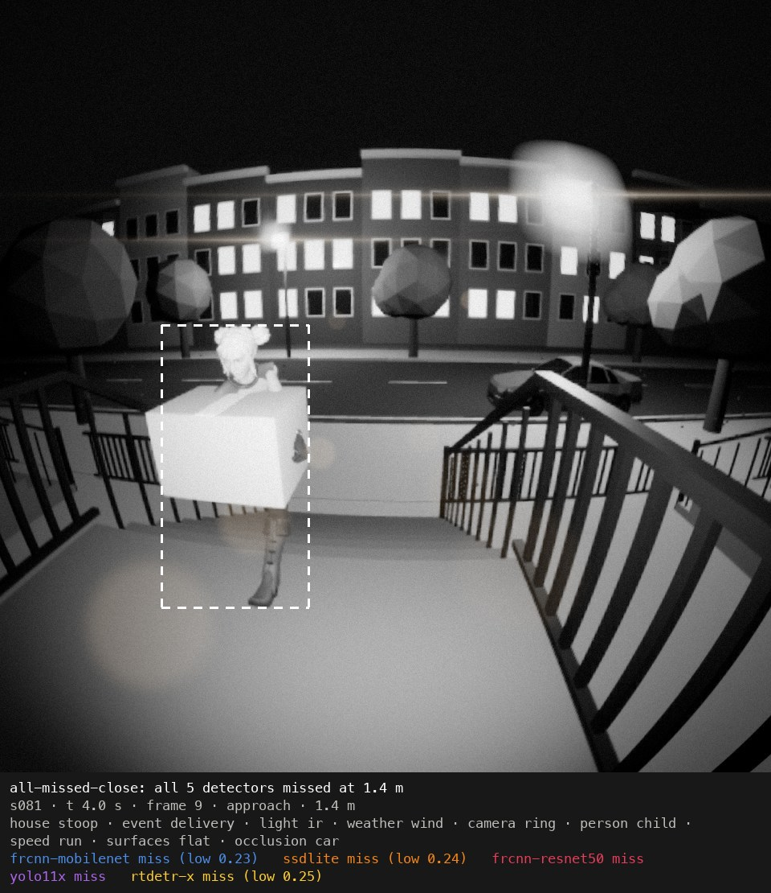

**all 5 detectors missed at 1.6 m**  
`s041` stoop · delivery · night · clear · fisheye · child · run · textured · bins · t 4 s · [frame](https://antioch-demo-hoeksema.vercel.app/?house=stoop&event=delivery&light=night&weather=clear&camera=ring&person=child&speed=run&surfaces=textured&occlusion=bins&seed=846545&view=doorbell&t=4) · [replay](https://antioch-demo-hoeksema.vercel.app/benchmarks?scenario=s041&detector=frcnn-resnet50)

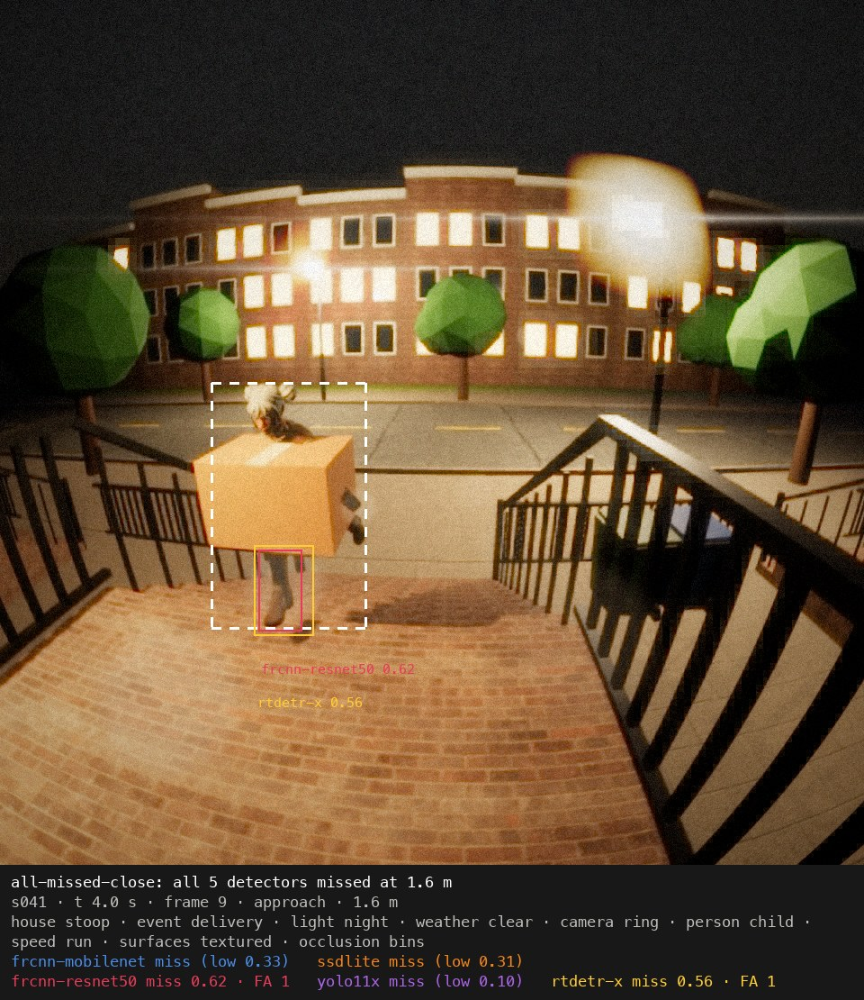

**all 5 detectors missed at 2.2 m**  
`s008` portico · delivery · night · wind · basic · child · run · textured · bins · t 6.5 s · [frame](https://antioch-demo-hoeksema.vercel.app/?house=portico&event=delivery&light=night&weather=wind&camera=basic&person=child&speed=run&surfaces=textured&occlusion=bins&seed=486396&view=doorbell&t=6.5) · [replay](https://antioch-demo-hoeksema.vercel.app/benchmarks?scenario=s008&detector=frcnn-resnet50)

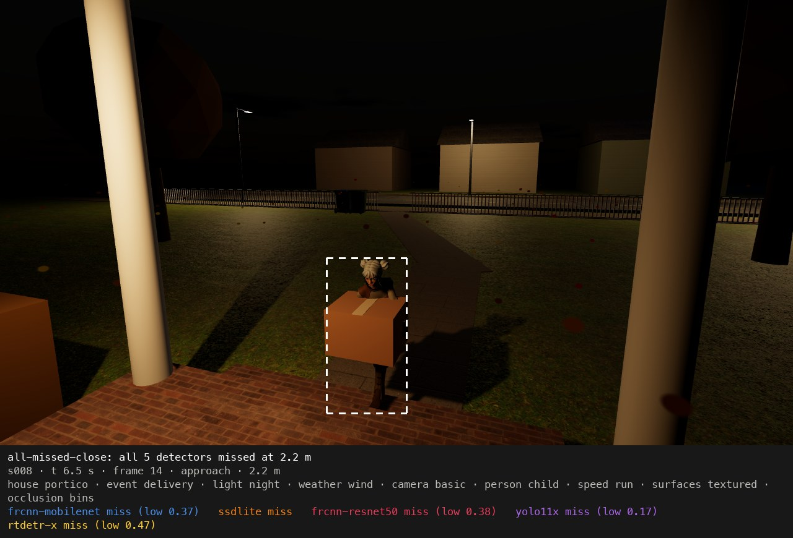

**all 5 detectors missed at 5.3 m**  
`s071` flush · delivery · night · clear · basic · woman · run · flat · bins · t 10 s · [frame](https://antioch-demo-hoeksema.vercel.app/?house=flush&event=delivery&light=night&weather=clear&camera=basic&person=woman&speed=run&surfaces=flat&occlusion=bins&seed=340563&view=doorbell&t=10) · [replay](https://antioch-demo-hoeksema.vercel.app/benchmarks?scenario=s071&detector=frcnn-resnet50)

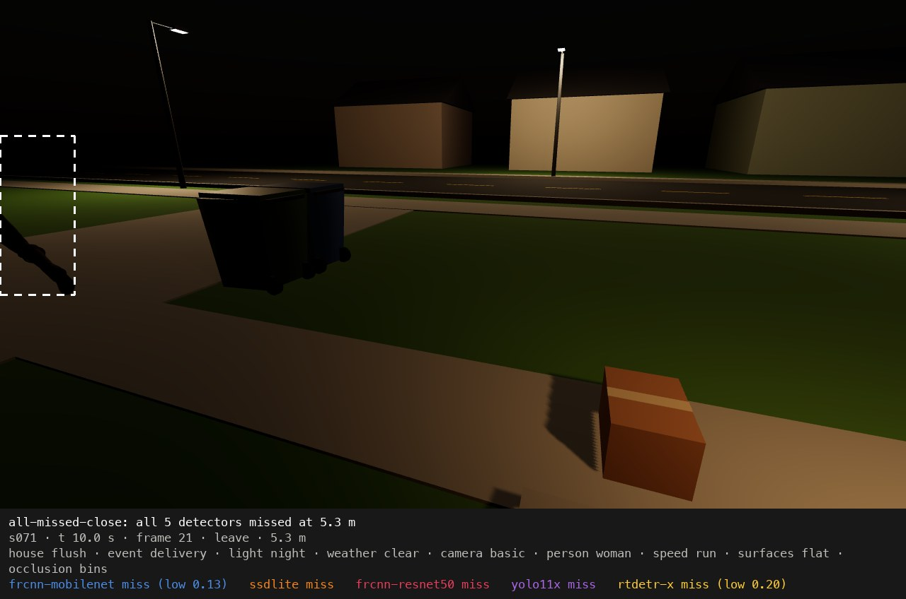

**all 5 detectors missed at 2.1 m**  
`s007` portico · delivery · dusk · fog · fisheye · child · walk · flat · car · t 18 s · [frame](https://antioch-demo-hoeksema.vercel.app/?house=portico&event=delivery&light=dusk&weather=fog&camera=ring&person=child&speed=walk&surfaces=flat&occlusion=car&seed=838091&view=doorbell&t=18) · [replay](https://antioch-demo-hoeksema.vercel.app/benchmarks?scenario=s007&detector=frcnn-resnet50)

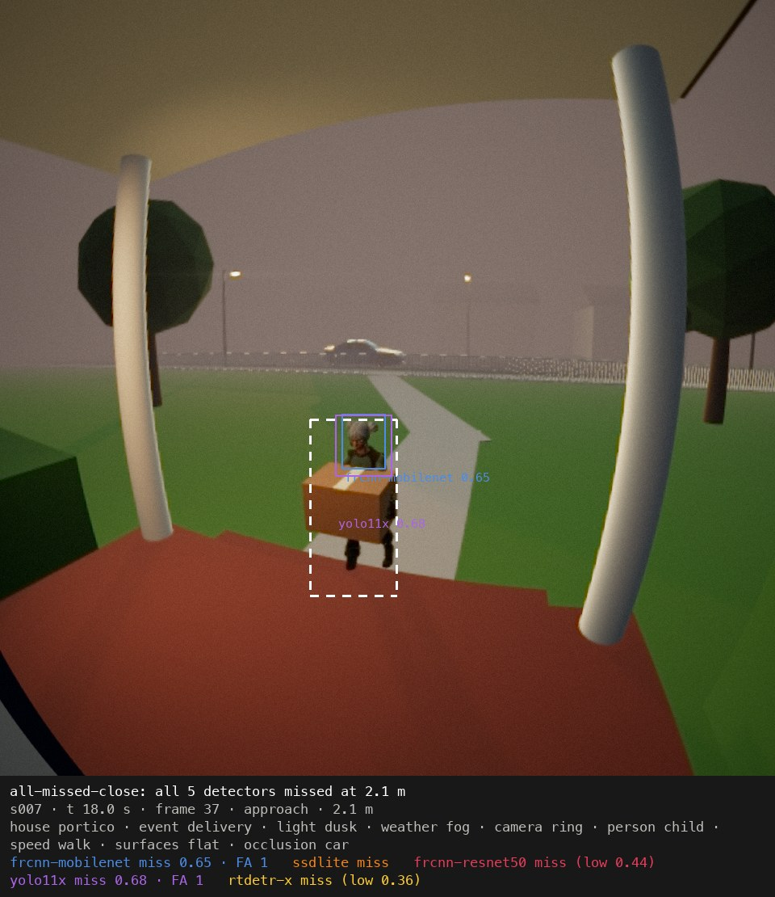

**all 5 detectors missed at 2.4 m**  
`s023` porch · delivery · IR · rain · fisheye · child · walk · flat · bins · t 16 s · [frame](https://antioch-demo-hoeksema.vercel.app/?house=porch&event=delivery&light=ir&weather=rain&camera=ring&person=child&speed=walk&surfaces=flat&occlusion=bins&seed=39387&view=doorbell&t=16) · [replay](https://antioch-demo-hoeksema.vercel.app/benchmarks?scenario=s023&detector=frcnn-resnet50)

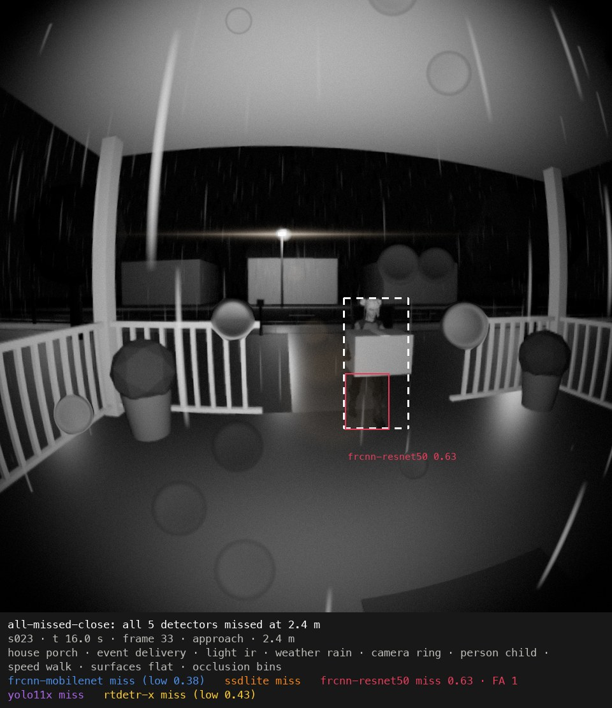

**all 5 detectors missed at 2.3 m**  
`s021` side · delivery · IR · snow · fisheye · child · walk · textured · car · t 16.5 s · [frame](https://antioch-demo-hoeksema.vercel.app/?house=side&event=delivery&light=ir&weather=snow&camera=ring&person=child&speed=walk&surfaces=textured&occlusion=car&seed=93988&view=doorbell&t=16.5) · [replay](https://antioch-demo-hoeksema.vercel.app/benchmarks?scenario=s021&detector=frcnn-resnet50)

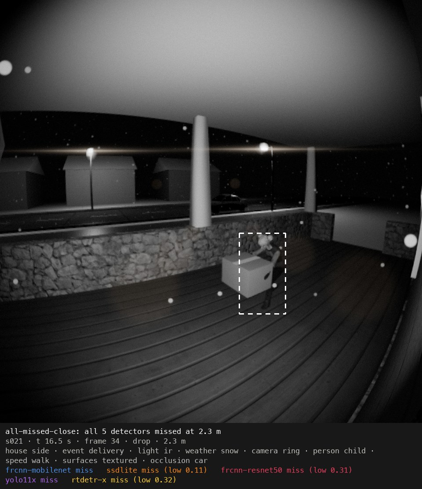

**all 5 detectors missed at 2.3 m**  
`s013` porch · delivery · night · wind · fisheye · child · run · textured · none · t 5.5 s · [frame](https://antioch-demo-hoeksema.vercel.app/?house=porch&event=delivery&light=night&weather=wind&camera=ring&person=child&speed=run&surfaces=textured&occlusion=none&seed=396111&view=doorbell&t=5.5) · [replay](https://antioch-demo-hoeksema.vercel.app/benchmarks?scenario=s013&detector=frcnn-resnet50)

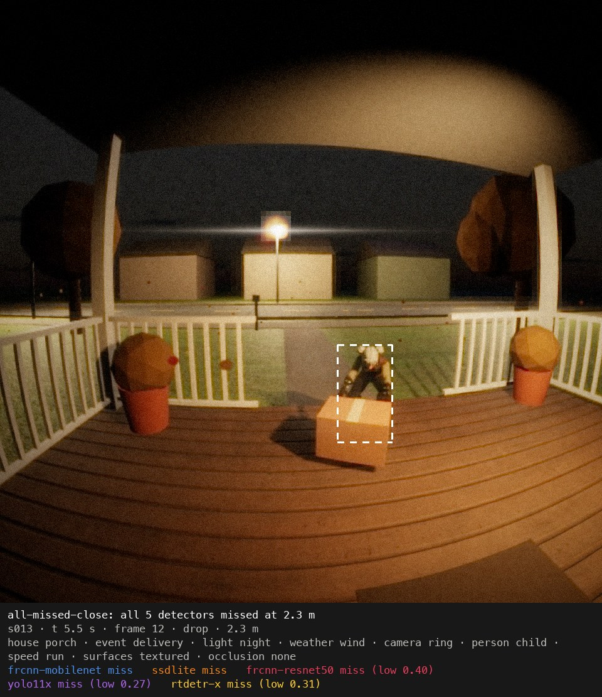

**all 5 detectors missed at 5.4 m**  
`s018` flush · delivery · dusk · fog · basic · hooded · walk · flat · bins · t 14.5 s · [frame](https://antioch-demo-hoeksema.vercel.app/?house=flush&event=delivery&light=dusk&weather=fog&camera=basic&person=hooded&speed=walk&surfaces=flat&occlusion=bins&seed=172307&view=doorbell&t=14.5) · [replay](https://antioch-demo-hoeksema.vercel.app/benchmarks?scenario=s018&detector=frcnn-resnet50)

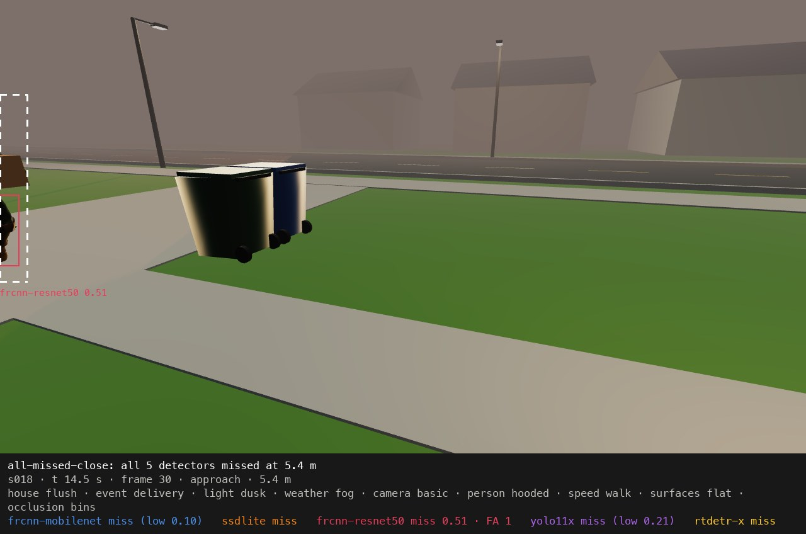

**all 5 detectors missed at 5.7 m**  
`s075` flush · delivery · night · rain · fisheye · dark · walk · textured · bins · t 14 s · [frame](https://antioch-demo-hoeksema.vercel.app/?house=flush&event=delivery&light=night&weather=rain&camera=ring&person=dark&speed=walk&surfaces=textured&occlusion=bins&seed=941301&view=doorbell&t=14) · [replay](https://antioch-demo-hoeksema.vercel.app/benchmarks?scenario=s075&detector=frcnn-resnet50)

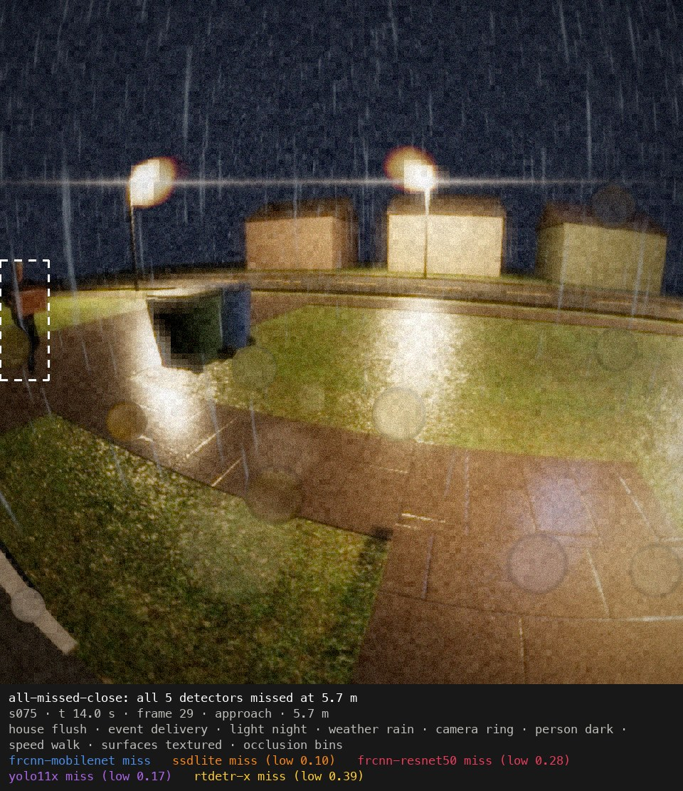

## Only one detector found the person

Exactly one detector hits. Farthest first.

**only frcnn-mobilenet found the person, at 12.1 m**  
`s017` portico · delivery · day · fog · basic · child · run · textured · none · t 3.5 s · [frame](https://antioch-demo-hoeksema.vercel.app/?house=portico&event=delivery&light=day&weather=fog&camera=basic&person=child&speed=run&surfaces=textured&occlusion=none&seed=200407&view=doorbell&t=3.5) · [replay](https://antioch-demo-hoeksema.vercel.app/benchmarks?scenario=s017&detector=frcnn-mobilenet)

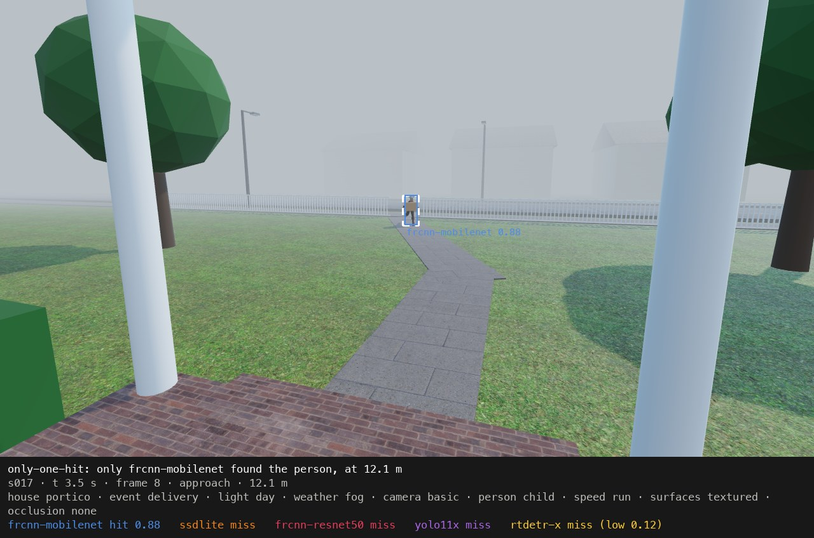

**only frcnn-mobilenet found the person, at 11.0 m**  
`s077` side · delivery · IR · clear · fisheye · hooded · walk · flat · none · t 6 s · [frame](https://antioch-demo-hoeksema.vercel.app/?house=side&event=delivery&light=ir&weather=clear&camera=ring&person=hooded&speed=walk&surfaces=flat&occlusion=none&seed=936595&view=doorbell&t=6) · [replay](https://antioch-demo-hoeksema.vercel.app/benchmarks?scenario=s077&detector=frcnn-mobilenet)

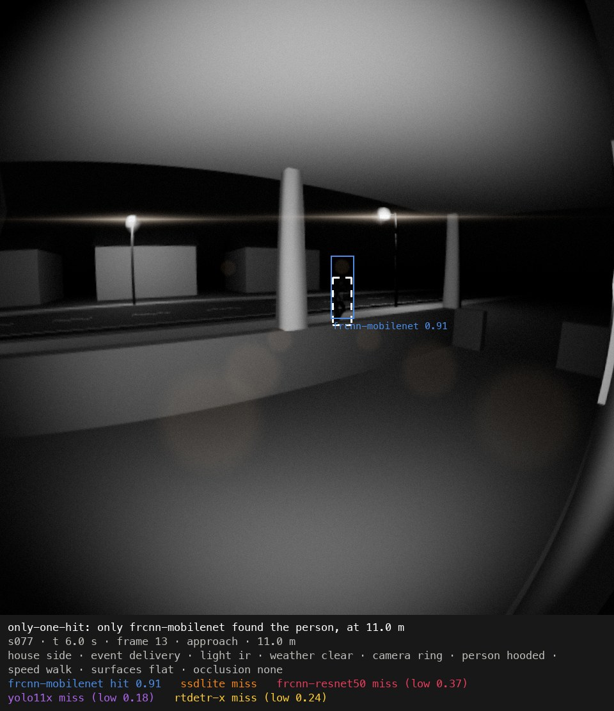

**only frcnn-mobilenet found the person, at 10.0 m**  
`s047` side · delivery · dusk · fog · fisheye · dark · run · textured · bins · t 2.5 s · [frame](https://antioch-demo-hoeksema.vercel.app/?house=side&event=delivery&light=dusk&weather=fog&camera=ring&person=dark&speed=run&surfaces=textured&occlusion=bins&seed=443198&view=doorbell&t=2.5) · [replay](https://antioch-demo-hoeksema.vercel.app/benchmarks?scenario=s047&detector=frcnn-mobilenet)

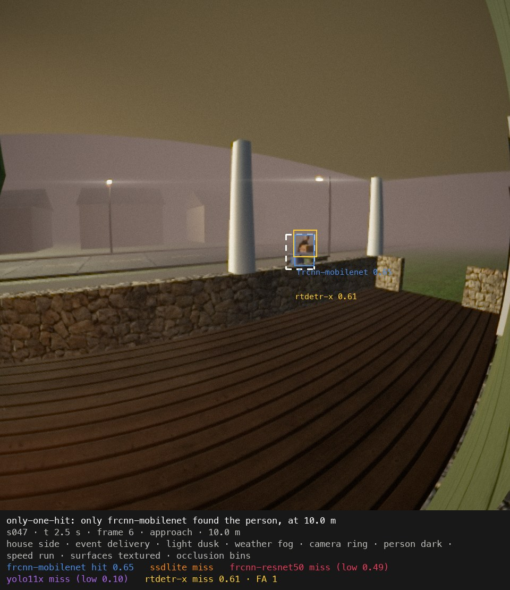

**only frcnn-resnet50 found the person, at 20.9 m**  
`s032` portico · delivery · night · clear · basic · man · walk · flat · car · t 42.5 s · [frame](https://antioch-demo-hoeksema.vercel.app/?house=portico&event=delivery&light=night&weather=clear&camera=basic&person=man&speed=walk&surfaces=flat&occlusion=car&seed=35605&view=doorbell&t=42.5) · [replay](https://antioch-demo-hoeksema.vercel.app/benchmarks?scenario=s032&detector=frcnn-resnet50)

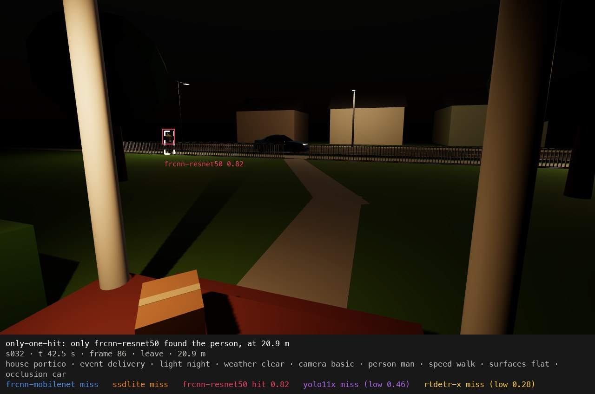

**only frcnn-resnet50 found the person, at 20.4 m**  
`s079` portico · delivery · dusk · clear · fisheye · dark · walk · flat · none · t 41.5 s · [frame](https://antioch-demo-hoeksema.vercel.app/?house=portico&event=delivery&light=dusk&weather=clear&camera=ring&person=dark&speed=walk&surfaces=flat&occlusion=none&seed=528283&view=doorbell&t=41.5) · [replay](https://antioch-demo-hoeksema.vercel.app/benchmarks?scenario=s079&detector=frcnn-resnet50)

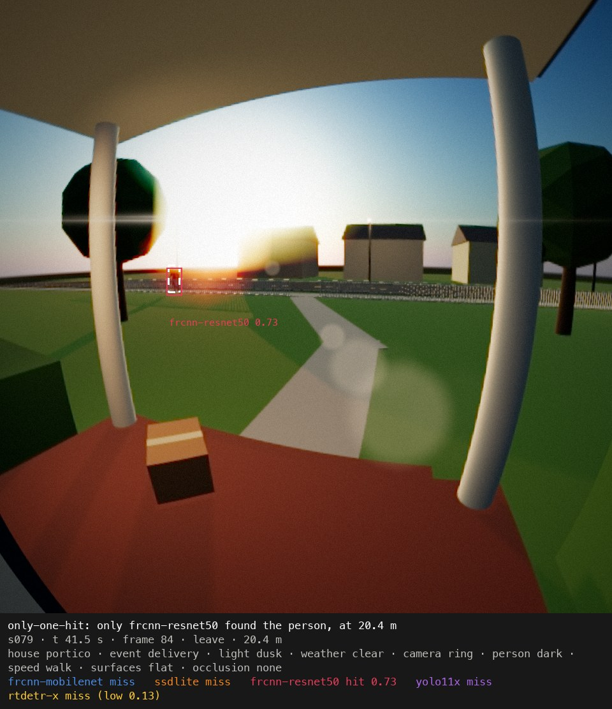

**only frcnn-resnet50 found the person, at 20.3 m**  
`s087` flush · delivery · IR · rain · basic · child · run · flat · car · t 13.5 s · [frame](https://antioch-demo-hoeksema.vercel.app/?house=flush&event=delivery&light=ir&weather=rain&camera=basic&person=child&speed=run&surfaces=flat&occlusion=car&seed=501438&view=doorbell&t=13.5) · [replay](https://antioch-demo-hoeksema.vercel.app/benchmarks?scenario=s087&detector=frcnn-resnet50)

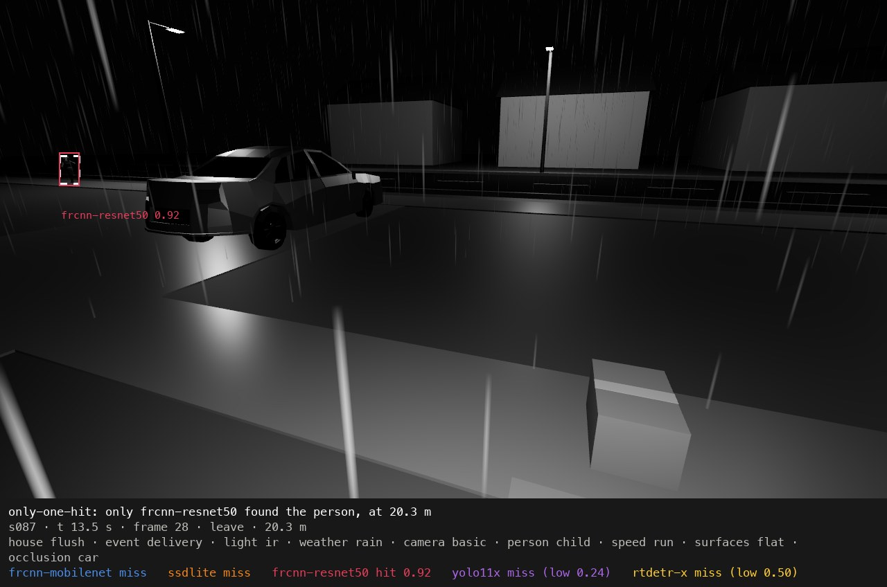

**only yolo11x found the person, at 22.8 m**  
`s032` portico · delivery · night · clear · basic · man · walk · flat · car · t 44.5 s · [frame](https://antioch-demo-hoeksema.vercel.app/?house=portico&event=delivery&light=night&weather=clear&camera=basic&person=man&speed=walk&surfaces=flat&occlusion=car&seed=35605&view=doorbell&t=44.5) · [replay](https://antioch-demo-hoeksema.vercel.app/benchmarks?scenario=s032&detector=yolo11x)

**only yolo11x found the person, at 18.9 m**  
`s064` portico · delivery · IR · rain · basic · hooded · walk · flat · none · t 2 s · [frame](https://antioch-demo-hoeksema.vercel.app/?house=portico&event=delivery&light=ir&weather=rain&camera=basic&person=hooded&speed=walk&surfaces=flat&occlusion=none&seed=862100&view=doorbell&t=2) · [replay](https://antioch-demo-hoeksema.vercel.app/benchmarks?scenario=s064&detector=yolo11x)

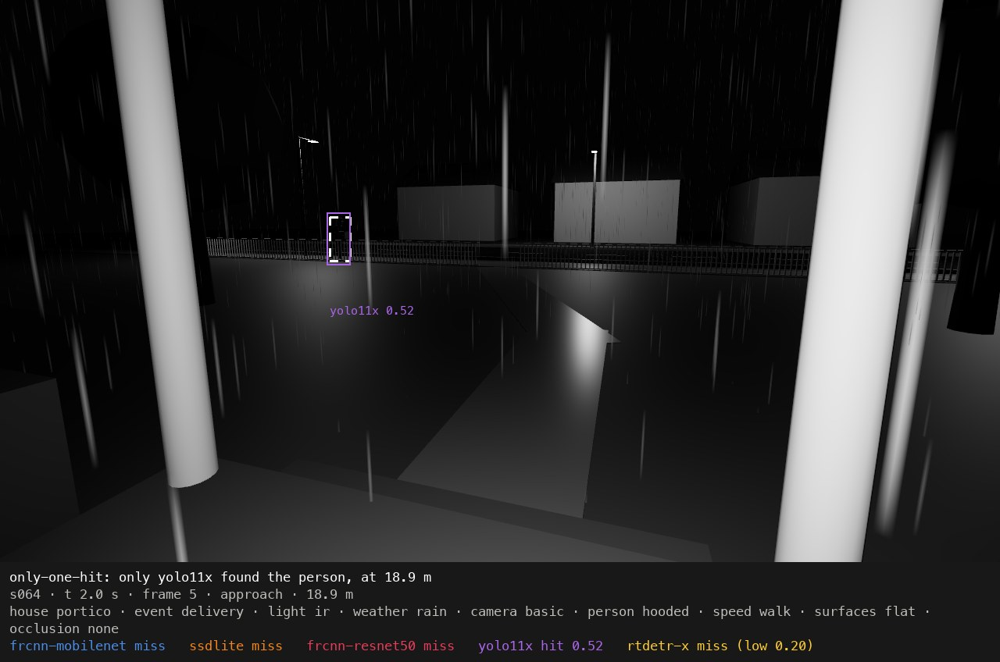

**only yolo11x found the person, at 17.3 m**  
`s066` flush · delivery · IR · snow · fisheye · dark · walk · textured · none · t 35 s · [frame](https://antioch-demo-hoeksema.vercel.app/?house=flush&event=delivery&light=ir&weather=snow&camera=ring&person=dark&speed=walk&surfaces=textured&occlusion=none&seed=777851&view=doorbell&t=35) · [replay](https://antioch-demo-hoeksema.vercel.app/benchmarks?scenario=s066&detector=yolo11x)

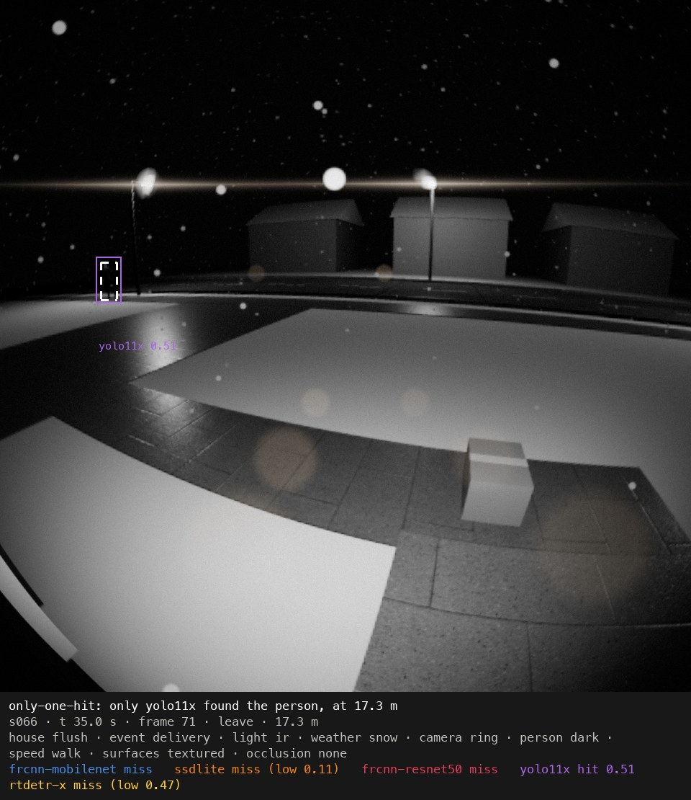

**only rtdetr-x found the person, at 22.1 m**  
`s032` portico · delivery · night · clear · basic · man · walk · flat · car · t 1 s · [frame](https://antioch-demo-hoeksema.vercel.app/?house=portico&event=delivery&light=night&weather=clear&camera=basic&person=man&speed=walk&surfaces=flat&occlusion=car&seed=35605&view=doorbell&t=1) · [replay](https://antioch-demo-hoeksema.vercel.app/benchmarks?scenario=s032&detector=rtdetr-x)

**only rtdetr-x found the person, at 21.7 m**  
`s086` flush · delivery · night · snow · basic · child · walk · flat · car · t 0 s · [frame](https://antioch-demo-hoeksema.vercel.app/?house=flush&event=delivery&light=night&weather=snow&camera=basic&person=child&speed=walk&surfaces=flat&occlusion=car&seed=349509&view=doorbell&t=0) · [replay](https://antioch-demo-hoeksema.vercel.app/benchmarks?scenario=s086&detector=rtdetr-x)

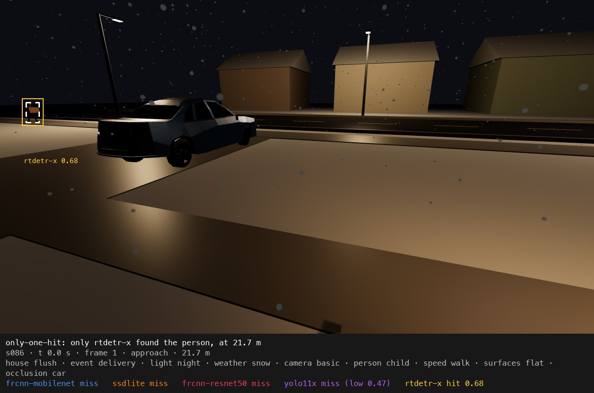

**only rtdetr-x found the person, at 20.2 m**  
`s066` flush · delivery · IR · snow · fisheye · dark · walk · textured · none · t 0 s · [frame](https://antioch-demo-hoeksema.vercel.app/?house=flush&event=delivery&light=ir&weather=snow&camera=ring&person=dark&speed=walk&surfaces=textured&occlusion=none&seed=777851&view=doorbell&t=0) · [replay](https://antioch-demo-hoeksema.vercel.app/benchmarks?scenario=s066&detector=rtdetr-x)

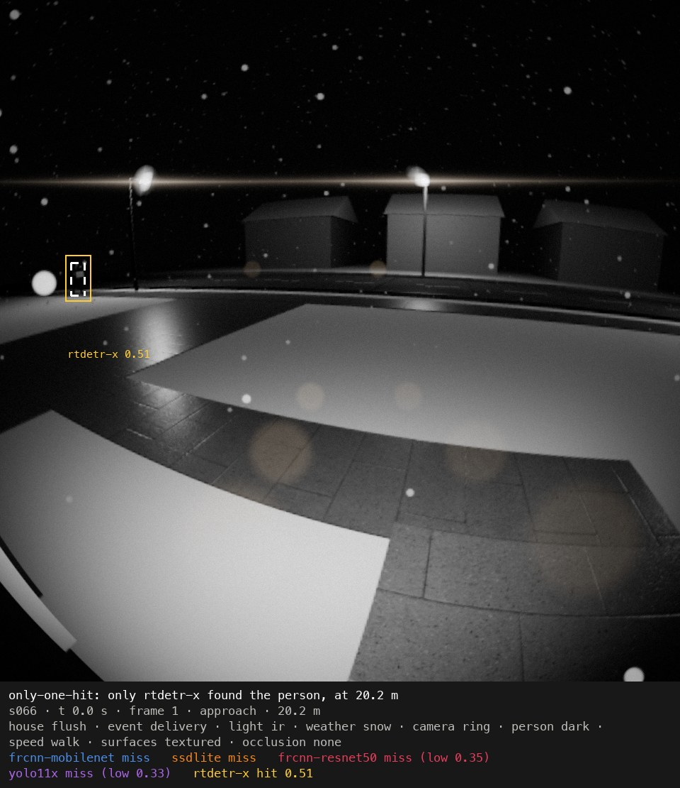

## Farthest hits

Each detector's farthest hits.

**frcnn-mobilenet: one of its farthest hits, at 21.6 m**  
`s006` flush · delivery · day · wind · basic · man · run · textured · none · t 0 s · [frame](https://antioch-demo-hoeksema.vercel.app/?house=flush&event=delivery&light=day&weather=wind&camera=basic&person=man&speed=run&surfaces=textured&occlusion=none&seed=594935&view=doorbell&t=0) · [replay](https://antioch-demo-hoeksema.vercel.app/benchmarks?scenario=s006&detector=frcnn-mobilenet)

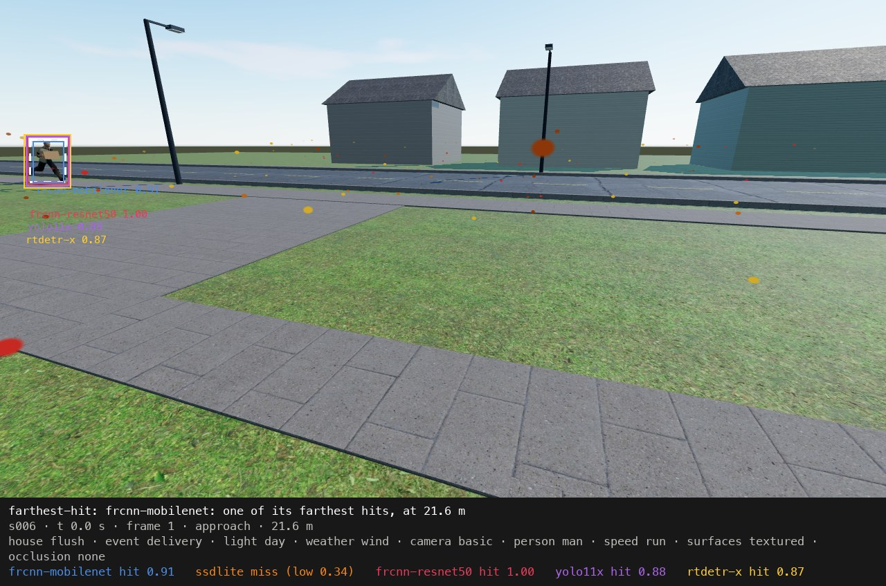

**frcnn-mobilenet: one of its farthest hits, at 21.2 m**  
`s018` flush · delivery · dusk · fog · basic · hooded · walk · flat · bins · t 0 s · [frame](https://antioch-demo-hoeksema.vercel.app/?house=flush&event=delivery&light=dusk&weather=fog&camera=basic&person=hooded&speed=walk&surfaces=flat&occlusion=bins&seed=172307&view=doorbell&t=0) · [replay](https://antioch-demo-hoeksema.vercel.app/benchmarks?scenario=s018&detector=frcnn-mobilenet)

**ssdlite: one of its farthest hits, at 7.4 m**  
`s006` flush · delivery · day · wind · basic · man · run · textured · none · t 11 s · [frame](https://antioch-demo-hoeksema.vercel.app/?house=flush&event=delivery&light=day&weather=wind&camera=basic&person=man&speed=run&surfaces=textured&occlusion=none&seed=594935&view=doorbell&t=11) · [replay](https://antioch-demo-hoeksema.vercel.app/benchmarks?scenario=s006&detector=ssdlite)

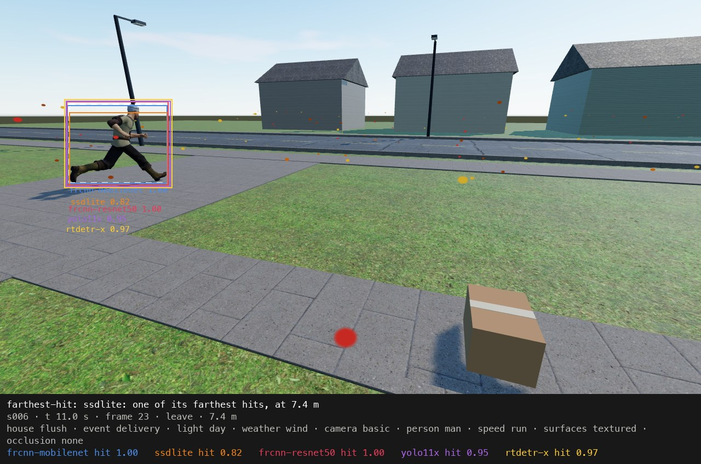

**ssdlite: one of its farthest hits, at 7.2 m**  
`s040` flush · delivery · dusk · rain · basic · dark · run · flat · none · t 11 s · [frame](https://antioch-demo-hoeksema.vercel.app/?house=flush&event=delivery&light=dusk&weather=rain&camera=basic&person=dark&speed=run&surfaces=flat&occlusion=none&seed=452974&view=doorbell&t=11) · [replay](https://antioch-demo-hoeksema.vercel.app/benchmarks?scenario=s040&detector=ssdlite)

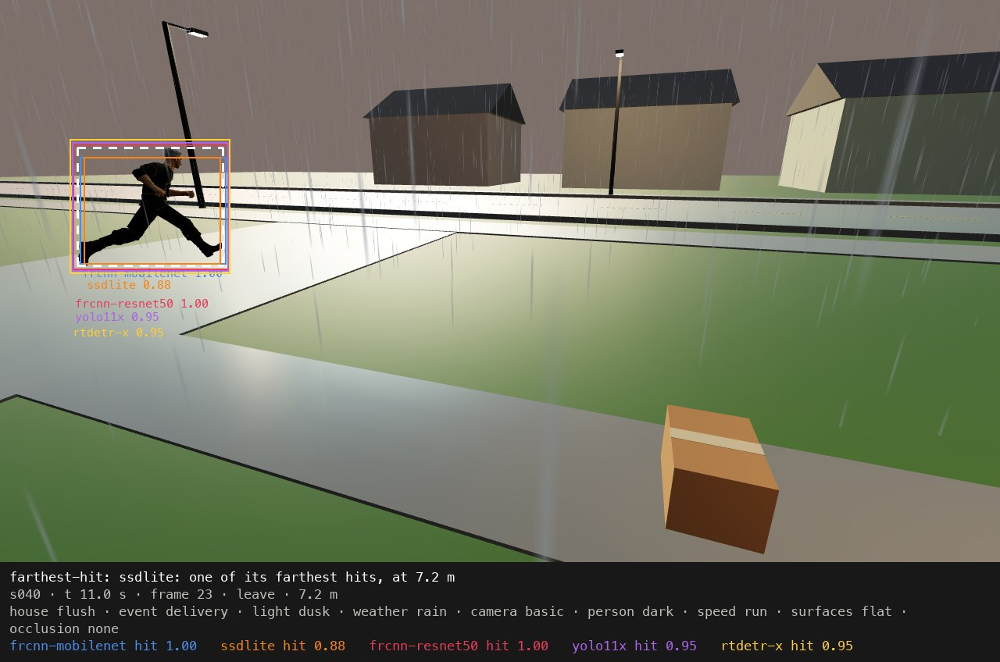

**frcnn-resnet50: one of its farthest hits, at 21.9 m**  
`s032` portico · delivery · night · clear · basic · man · walk · flat · car · t 43.5 s · [frame](https://antioch-demo-hoeksema.vercel.app/?house=portico&event=delivery&light=night&weather=clear&camera=basic&person=man&speed=walk&surfaces=flat&occlusion=car&seed=35605&view=doorbell&t=43.5) · [replay](https://antioch-demo-hoeksema.vercel.app/benchmarks?scenario=s032&detector=frcnn-resnet50)

**frcnn-resnet50: one of its farthest hits, at 21.7 m**  
`s062` flush · delivery · day · wind · fisheye · child · walk · flat · bins · t 0 s · [frame](https://antioch-demo-hoeksema.vercel.app/?house=flush&event=delivery&light=day&weather=wind&camera=ring&person=child&speed=walk&surfaces=flat&occlusion=bins&seed=170936&view=doorbell&t=0) · [replay](https://antioch-demo-hoeksema.vercel.app/benchmarks?scenario=s062&detector=frcnn-resnet50)

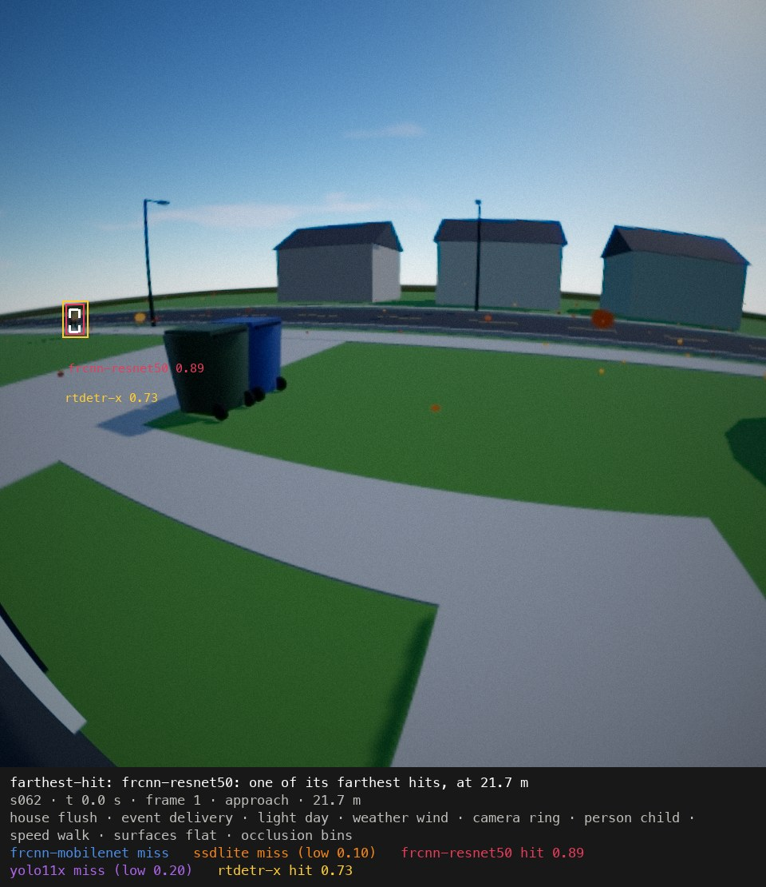

**yolo11x: one of its farthest hits, at 22.3 m**  
`s032` portico · delivery · night · clear · basic · man · walk · flat · car · t 44 s · [frame](https://antioch-demo-hoeksema.vercel.app/?house=portico&event=delivery&light=night&weather=clear&camera=basic&person=man&speed=walk&surfaces=flat&occlusion=car&seed=35605&view=doorbell&t=44) · [replay](https://antioch-demo-hoeksema.vercel.app/benchmarks?scenario=s032&detector=yolo11x)

**yolo11x: one of its farthest hits, at 21.6 m**  
`s046` flush · delivery · IR · wind · fisheye · man · walk · flat · car · t 0 s · [frame](https://antioch-demo-hoeksema.vercel.app/?house=flush&event=delivery&light=ir&weather=wind&camera=ring&person=man&speed=walk&surfaces=flat&occlusion=car&seed=778441&view=doorbell&t=0) · [replay](https://antioch-demo-hoeksema.vercel.app/benchmarks?scenario=s046&detector=yolo11x)

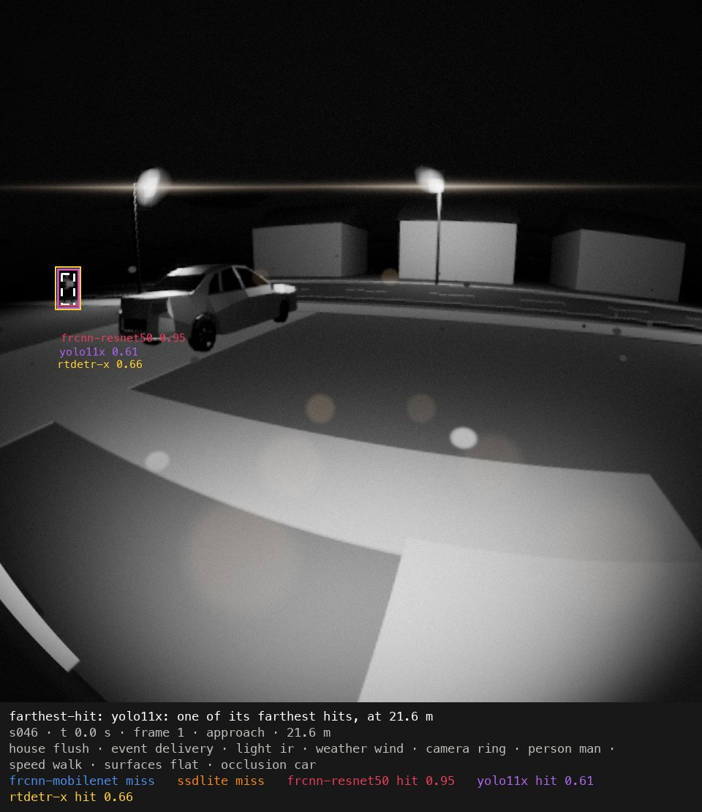

**rtdetr-x: one of its farthest hits, at 21.6 m**  
`s032` portico · delivery · night · clear · basic · man · walk · flat · car · t 1.5 s · [frame](https://antioch-demo-hoeksema.vercel.app/?house=portico&event=delivery&light=night&weather=clear&camera=basic&person=man&speed=walk&surfaces=flat&occlusion=car&seed=35605&view=doorbell&t=1.5) · [replay](https://antioch-demo-hoeksema.vercel.app/benchmarks?scenario=s032&detector=rtdetr-x)

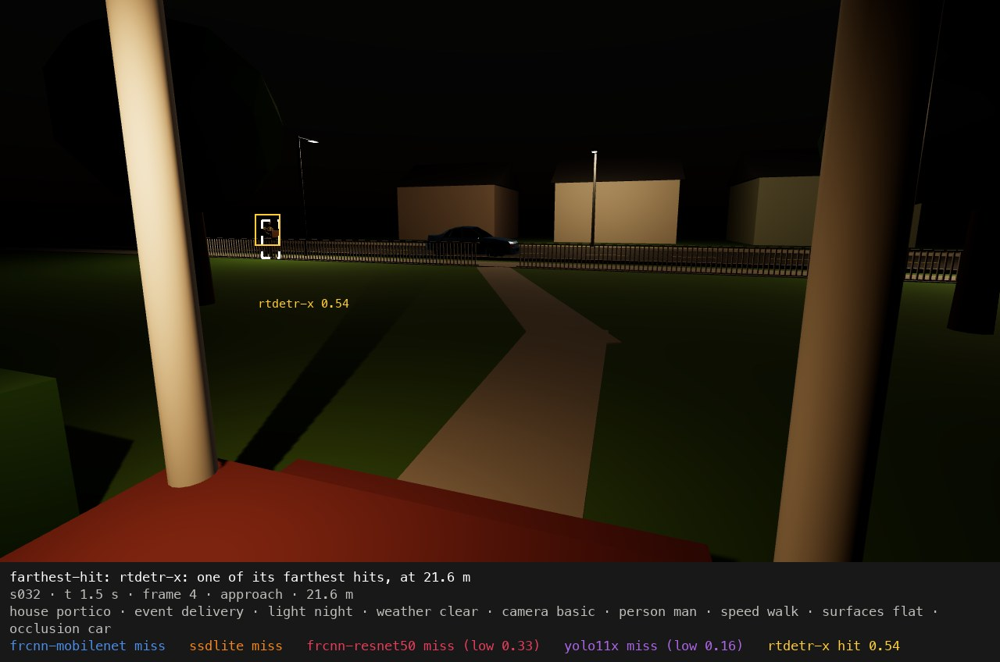

**rtdetr-x: one of its farthest hits, at 21.5 m**  
`s086` flush · delivery · night · snow · basic · child · walk · flat · car · t 38.5 s · [frame](https://antioch-demo-hoeksema.vercel.app/?house=flush&event=delivery&light=night&weather=snow&camera=basic&person=child&speed=walk&surfaces=flat&occlusion=car&seed=349509&view=doorbell&t=38.5) · [replay](https://antioch-demo-hoeksema.vercel.app/benchmarks?scenario=s086&detector=rtdetr-x)

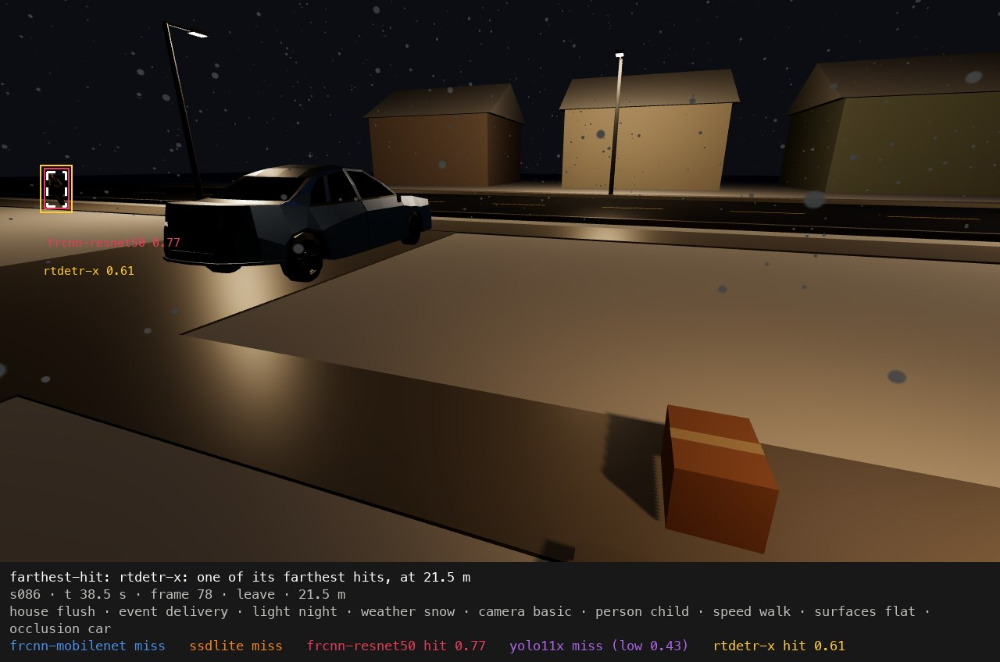

## Low light on the fisheye: every detector hit

Dusk, night, or IR on the fisheye camera, and all detectors find the person.

**every detector hit in low light on the fisheye, at 4.1 m**  
`s047` side · delivery · dusk · fog · fisheye · dark · run · textured · bins · t 8.5 s · [frame](https://antioch-demo-hoeksema.vercel.app/?house=side&event=delivery&light=dusk&weather=fog&camera=ring&person=dark&speed=run&surfaces=textured&occlusion=bins&seed=443198&view=doorbell&t=8.5) · [replay](https://antioch-demo-hoeksema.vercel.app/benchmarks?scenario=s047&detector=frcnn-resnet50)

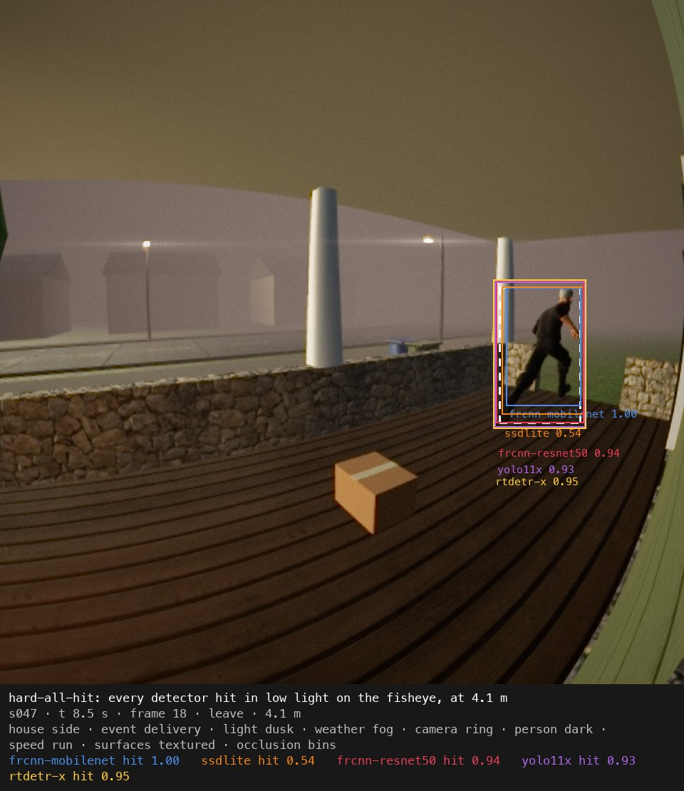

**every detector hit in low light on the fisheye, at 3.9 m**  
`s046` flush · delivery · IR · wind · fisheye · man · walk · flat · car · t 26 s · [frame](https://antioch-demo-hoeksema.vercel.app/?house=flush&event=delivery&light=ir&weather=wind&camera=ring&person=man&speed=walk&surfaces=flat&occlusion=car&seed=778441&view=doorbell&t=26) · [replay](https://antioch-demo-hoeksema.vercel.app/benchmarks?scenario=s046&detector=frcnn-resnet50)

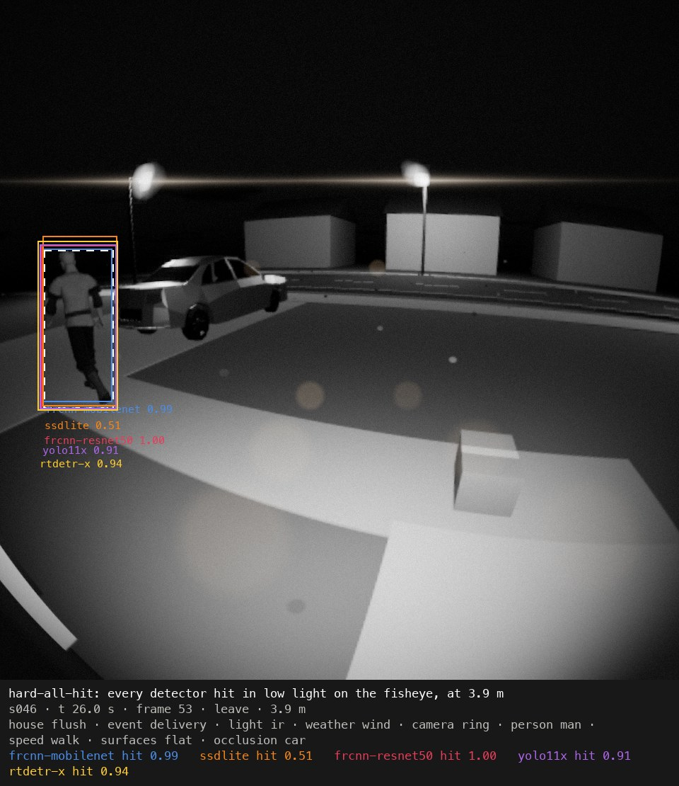

**every detector hit in low light on the fisheye, at 3.6 m**  
`s003` flush · delivery · dusk · clear · fisheye · woman · walk · textured · car · t 24.5 s · [frame](https://antioch-demo-hoeksema.vercel.app/?house=flush&event=delivery&light=dusk&weather=clear&camera=ring&person=woman&speed=walk&surfaces=textured&occlusion=car&seed=839149&view=doorbell&t=24.5) · [replay](https://antioch-demo-hoeksema.vercel.app/benchmarks?scenario=s003&detector=frcnn-resnet50)

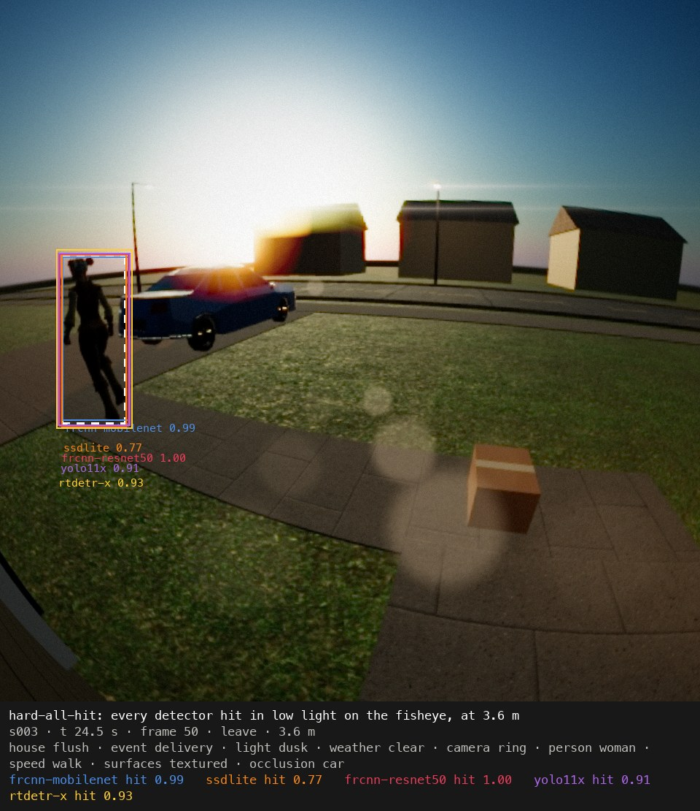

**every detector hit in low light on the fisheye, at 3.6 m**  
`s096` side · delivery · dusk · wind · fisheye · dark · walk · flat · car · t 14 s · [frame](https://antioch-demo-hoeksema.vercel.app/?house=side&event=delivery&light=dusk&weather=wind&camera=ring&person=dark&speed=walk&surfaces=flat&occlusion=car&seed=884080&view=doorbell&t=14) · [replay](https://antioch-demo-hoeksema.vercel.app/benchmarks?scenario=s096&detector=frcnn-resnet50)

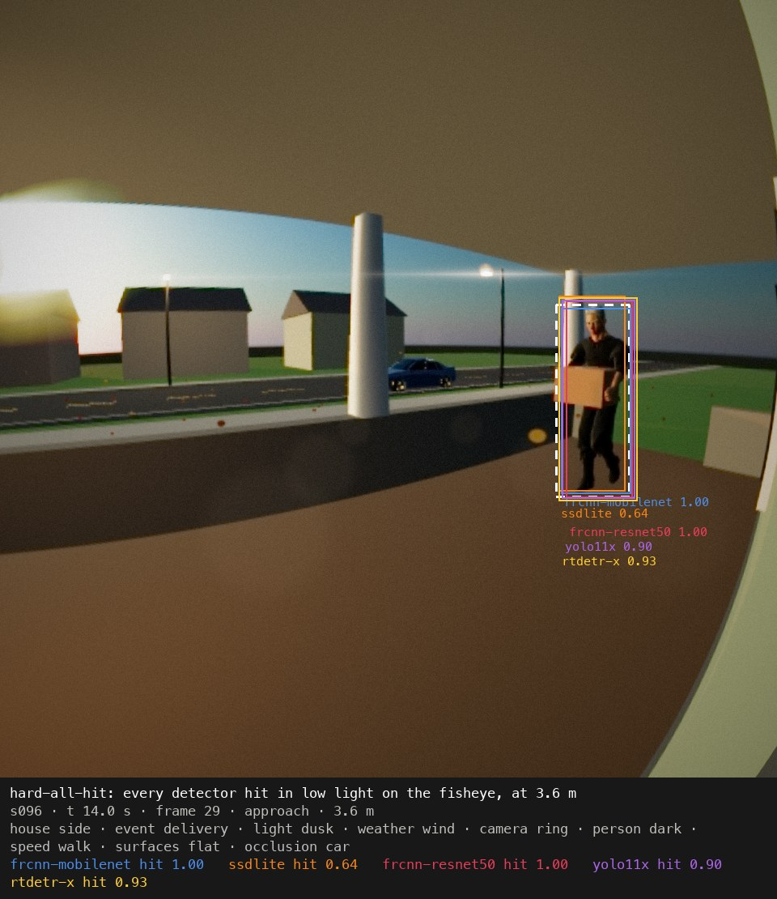

**every detector hit in low light on the fisheye, at 3.5 m**  
`s077` side · delivery · IR · clear · fisheye · hooded · walk · flat · none · t 19.5 s · [frame](https://antioch-demo-hoeksema.vercel.app/?house=side&event=delivery&light=ir&weather=clear&camera=ring&person=hooded&speed=walk&surfaces=flat&occlusion=none&seed=936595&view=doorbell&t=19.5) · [replay](https://antioch-demo-hoeksema.vercel.app/benchmarks?scenario=s077&detector=frcnn-resnet50)

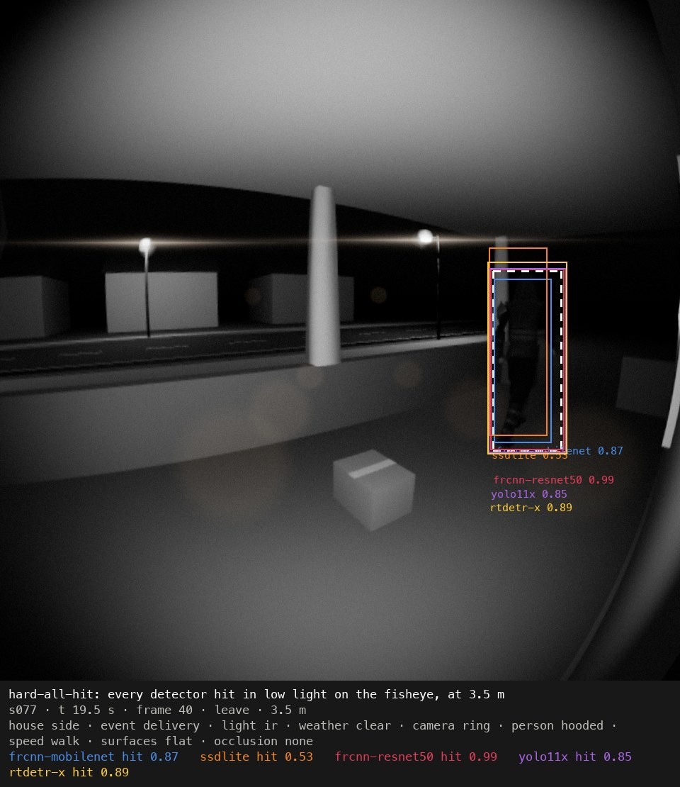

**every detector hit in low light on the fisheye, at 3.3 m**  
`s079` portico · delivery · dusk · clear · fisheye · dark · walk · flat · none · t 24.5 s · [frame](https://antioch-demo-hoeksema.vercel.app/?house=portico&event=delivery&light=dusk&weather=clear&camera=ring&person=dark&speed=walk&surfaces=flat&occlusion=none&seed=528283&view=doorbell&t=24.5) · [replay](https://antioch-demo-hoeksema.vercel.app/benchmarks?scenario=s079&detector=frcnn-resnet50)

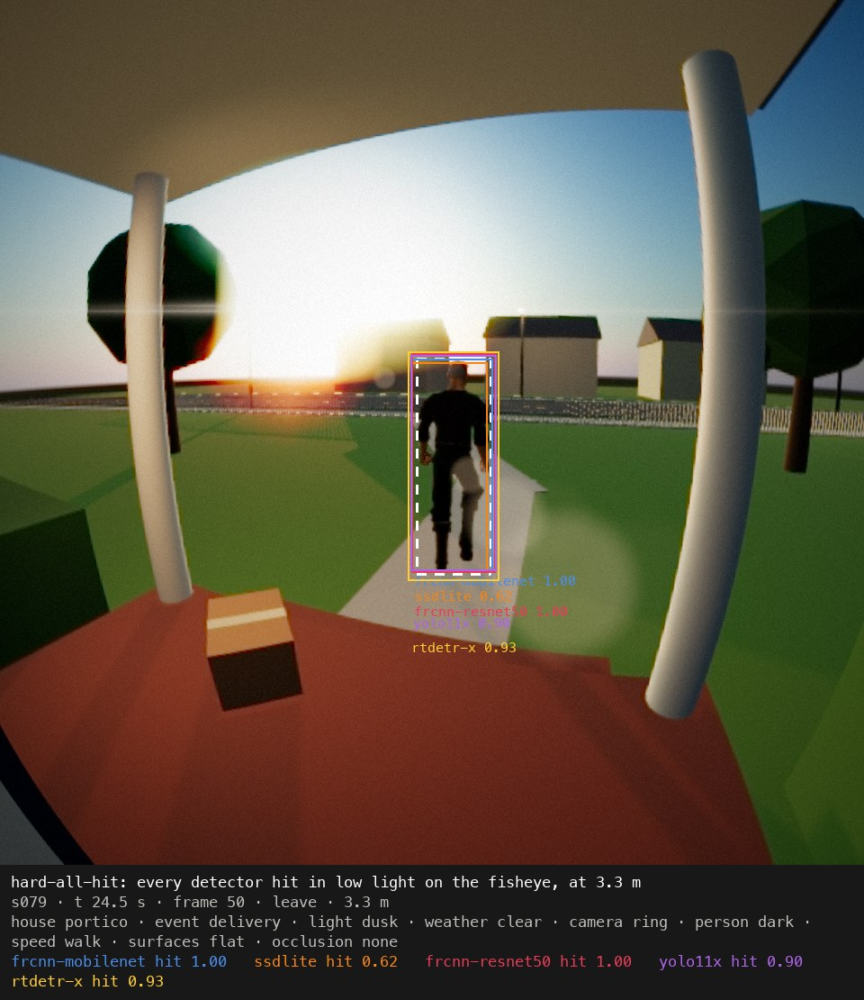

## One pair for each light

For each light: the farthest frame where most detectors hit, and the nearest frame where all miss.

**light day: 4 of 5 hit, at 20.7 m (farthest such frame)**  
`s006` flush · delivery · day · wind · basic · man · run · textured · none · t 15 s · [frame](https://antioch-demo-hoeksema.vercel.app/?house=flush&event=delivery&light=day&weather=wind&camera=basic&person=man&speed=run&surfaces=textured&occlusion=none&seed=594935&view=doorbell&t=15) · [replay](https://antioch-demo-hoeksema.vercel.app/benchmarks?scenario=s006&detector=frcnn-resnet50)

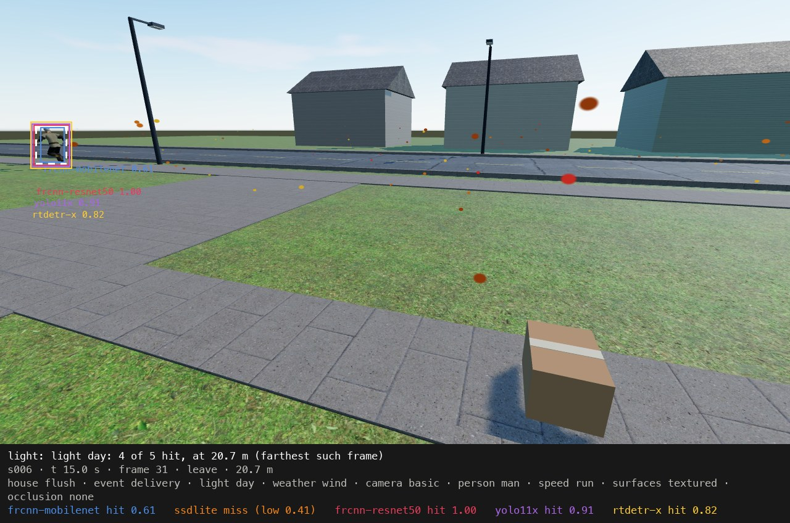

**light day: all missed, at 4.1 m (nearest such frame)**  
`s028` stoop · delivery · day · rain · fisheye · woman · run · flat · car · t 4 s · [frame](https://antioch-demo-hoeksema.vercel.app/?house=stoop&event=delivery&light=day&weather=rain&camera=ring&person=woman&speed=run&surfaces=flat&occlusion=car&seed=704507&view=doorbell&t=4) · [replay](https://antioch-demo-hoeksema.vercel.app/benchmarks?scenario=s028&detector=frcnn-resnet50)

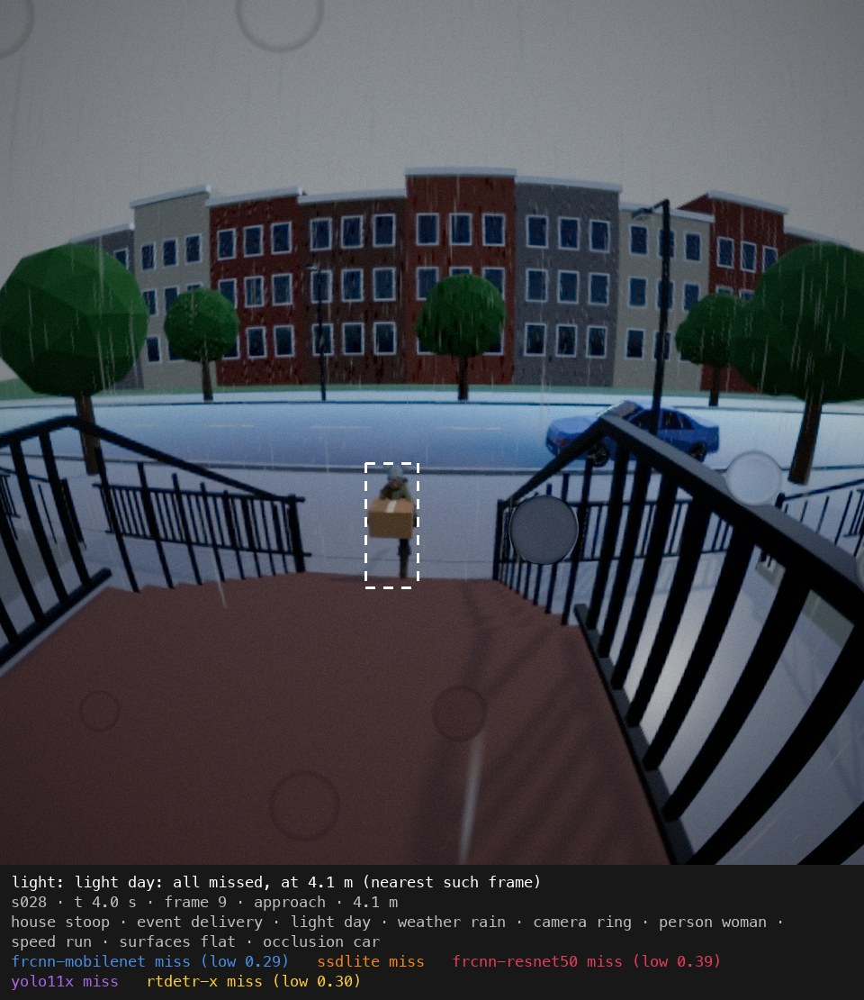

**light dusk: 4 of 5 hit, at 19.9 m (farthest such frame)**  
`s018` flush · delivery · dusk · fog · basic · hooded · walk · flat · bins · t 1 s · [frame](https://antioch-demo-hoeksema.vercel.app/?house=flush&event=delivery&light=dusk&weather=fog&camera=basic&person=hooded&speed=walk&surfaces=flat&occlusion=bins&seed=172307&view=doorbell&t=1) · [replay](https://antioch-demo-hoeksema.vercel.app/benchmarks?scenario=s018&detector=frcnn-resnet50)

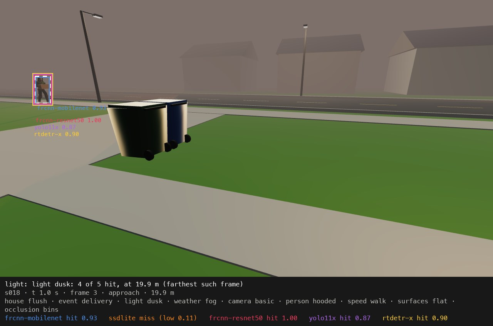

**light dusk: all missed, at 2.8 m (nearest such frame)**  
`s007` portico · delivery · dusk · fog · fisheye · child · walk · flat · car · t 17.5 s · [frame](https://antioch-demo-hoeksema.vercel.app/?house=portico&event=delivery&light=dusk&weather=fog&camera=ring&person=child&speed=walk&surfaces=flat&occlusion=car&seed=838091&view=doorbell&t=17.5) · [replay](https://antioch-demo-hoeksema.vercel.app/benchmarks?scenario=s007&detector=frcnn-resnet50)

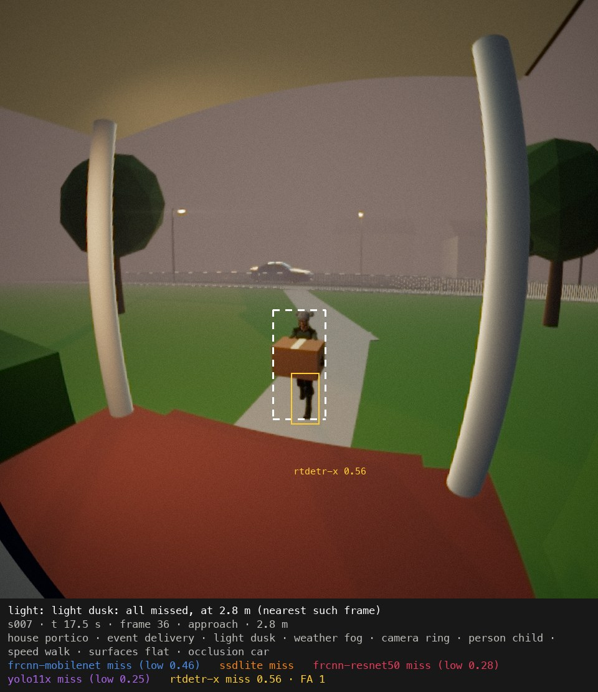

**light night: 4 of 5 hit, at 19.0 m (farthest such frame)**  
`s048` flush · delivery · night · fog · basic · dark · walk · textured · none · t 0 s · [frame](https://antioch-demo-hoeksema.vercel.app/?house=flush&event=delivery&light=night&weather=fog&camera=basic&person=dark&speed=walk&surfaces=textured&occlusion=none&seed=820928&view=doorbell&t=0) · [replay](https://antioch-demo-hoeksema.vercel.app/benchmarks?scenario=s048&detector=frcnn-resnet50)

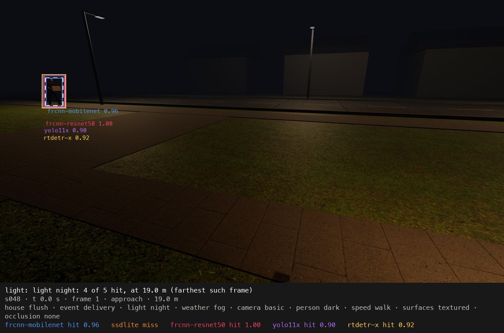

**light night: all missed, at 3.4 m (nearest such frame)**  
`s041` stoop · delivery · night · clear · fisheye · child · run · textured · bins · t 3.5 s · [frame](https://antioch-demo-hoeksema.vercel.app/?house=stoop&event=delivery&light=night&weather=clear&camera=ring&person=child&speed=run&surfaces=textured&occlusion=bins&seed=846545&view=doorbell&t=3.5) · [replay](https://antioch-demo-hoeksema.vercel.app/benchmarks?scenario=s041&detector=frcnn-resnet50)

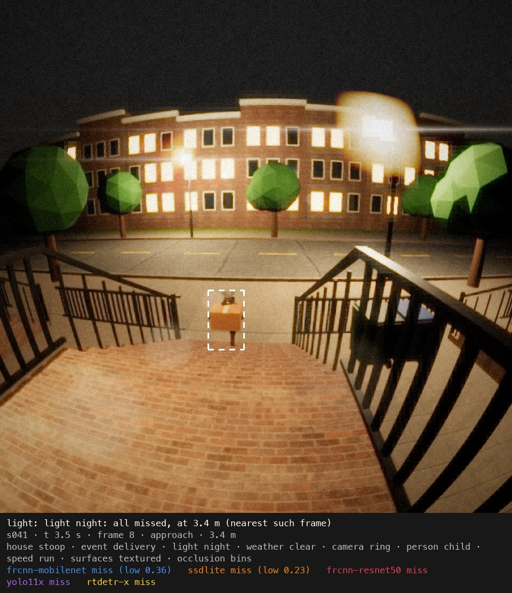

**light ir: 4 of 5 hit, at 20.1 m (farthest such frame)**  
`s046` flush · delivery · IR · wind · fisheye · man · walk · flat · car · t 42.5 s · [frame](https://antioch-demo-hoeksema.vercel.app/?house=flush&event=delivery&light=ir&weather=wind&camera=ring&person=man&speed=walk&surfaces=flat&occlusion=car&seed=778441&view=doorbell&t=42.5) · [replay](https://antioch-demo-hoeksema.vercel.app/benchmarks?scenario=s046&detector=frcnn-resnet50)

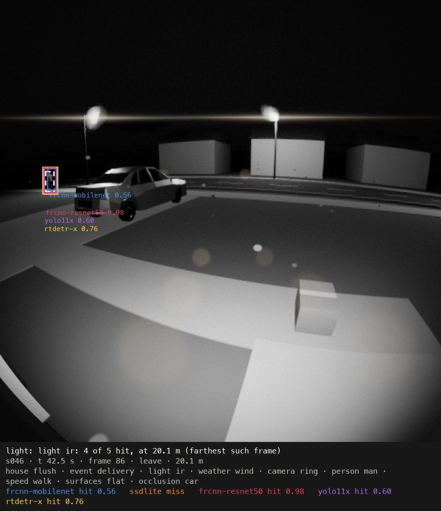

**light ir: all missed, at 2.3 m (nearest such frame)**  
`s023` porch · delivery · IR · rain · fisheye · child · walk · flat · bins · t 17 s · [frame](https://antioch-demo-hoeksema.vercel.app/?house=porch&event=delivery&light=ir&weather=rain&camera=ring&person=child&speed=walk&surfaces=flat&occlusion=bins&seed=39387&view=doorbell&t=17) · [replay](https://antioch-demo-hoeksema.vercel.app/benchmarks?scenario=s023&detector=frcnn-resnet50)

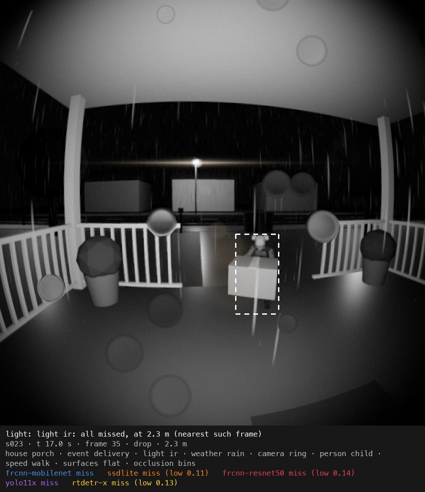

## Child height: every detector missed

The weakest person setting.

**child height: all missed at 3.0 m**  
`s021` side · delivery · IR · snow · fisheye · child · walk · textured · car · t 15 s · [frame](https://antioch-demo-hoeksema.vercel.app/?house=side&event=delivery&light=ir&weather=snow&camera=ring&person=child&speed=walk&surfaces=textured&occlusion=car&seed=93988&view=doorbell&t=15) · [replay](https://antioch-demo-hoeksema.vercel.app/benchmarks?scenario=s021&detector=frcnn-resnet50)

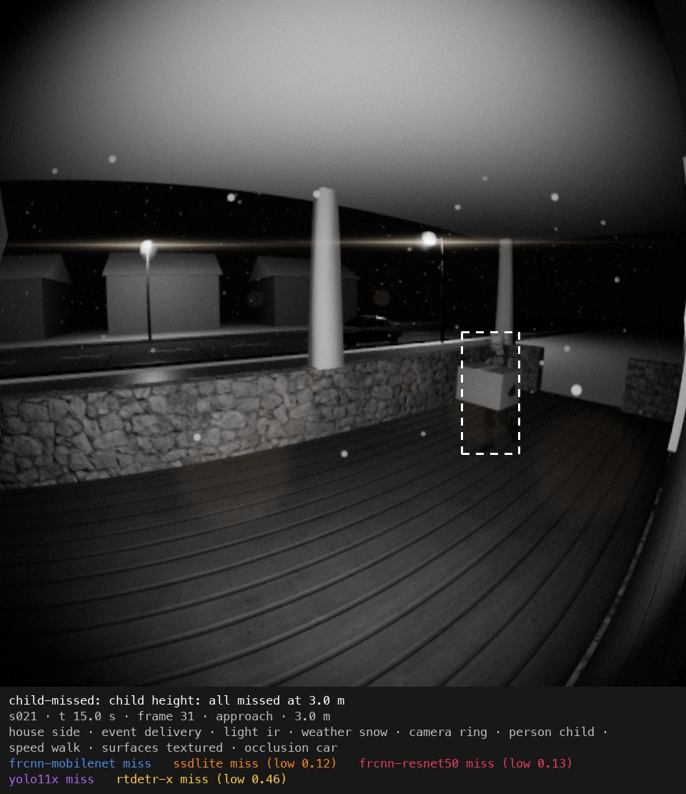

**child height: all missed at 3.0 m**  
`s023` porch · delivery · IR · rain · fisheye · child · walk · flat · bins · t 15.5 s · [frame](https://antioch-demo-hoeksema.vercel.app/?house=porch&event=delivery&light=ir&weather=rain&camera=ring&person=child&speed=walk&surfaces=flat&occlusion=bins&seed=39387&view=doorbell&t=15.5) · [replay](https://antioch-demo-hoeksema.vercel.app/benchmarks?scenario=s023&detector=frcnn-resnet50)

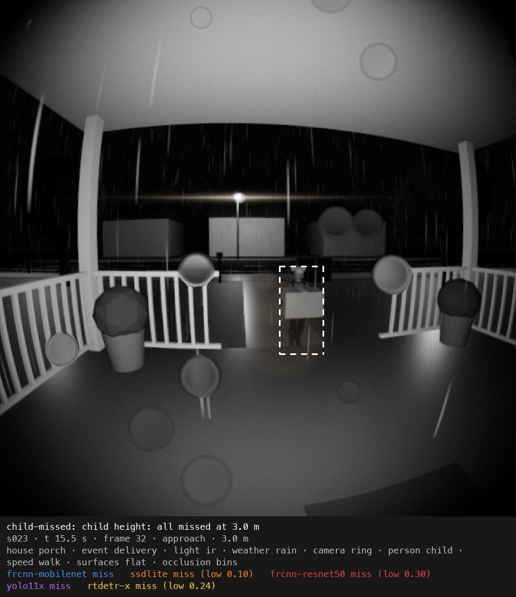

**child height: all missed at 7.2 m**  
`s087` flush · delivery · IR · rain · basic · child · run · flat · car · t 10 s · [frame](https://antioch-demo-hoeksema.vercel.app/?house=flush&event=delivery&light=ir&weather=rain&camera=basic&person=child&speed=run&surfaces=flat&occlusion=car&seed=501438&view=doorbell&t=10) · [replay](https://antioch-demo-hoeksema.vercel.app/benchmarks?scenario=s087&detector=frcnn-resnet50)

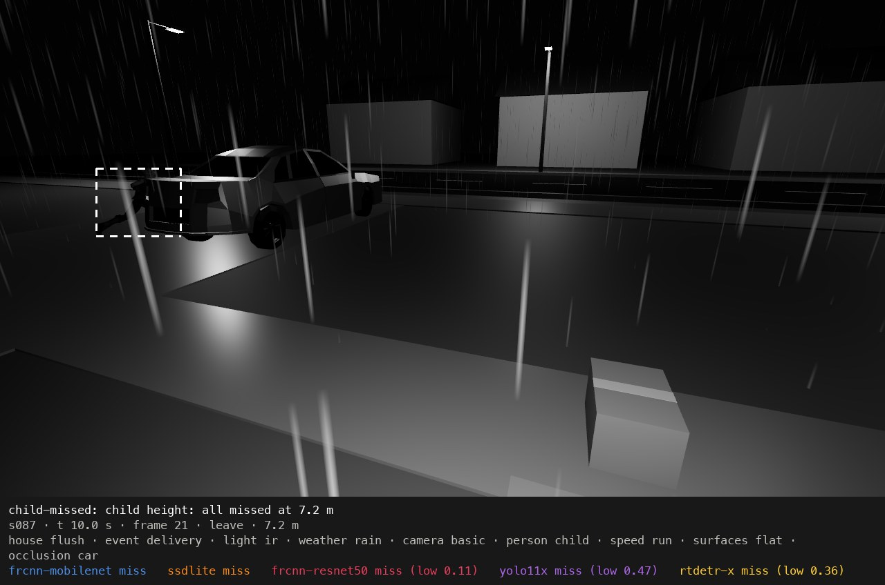

## False alarms with no person

Person boxes in scenes with a dog, a passing car, or nobody. Highest scores first.

**frcnn-mobilenet: a person box at 0.86 with no person in the scene**  
`s033` stoop · empty · day · snow · fisheye · textured · bins · t 4.5 s · [frame](https://antioch-demo-hoeksema.vercel.app/?house=stoop&event=empty&light=day&weather=snow&camera=ring&person=man&speed=walk&surfaces=textured&occlusion=bins&seed=882504&view=doorbell&t=4.5) · [replay](https://antioch-demo-hoeksema.vercel.app/benchmarks?scenario=s033&detector=frcnn-mobilenet)

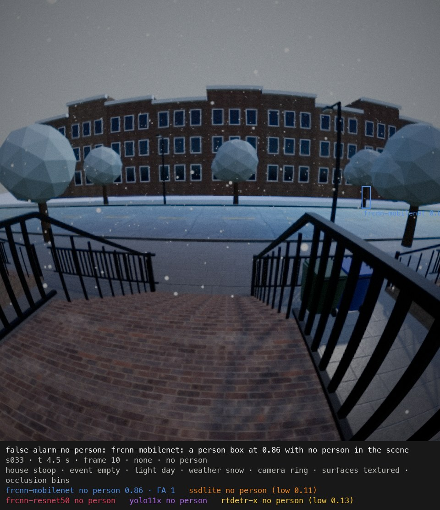

**frcnn-mobilenet: a person box at 0.79 with no person in the scene**  
`s093` stoop · dog · night · fog · basic · flat · car · t 13.5 s · [frame](https://antioch-demo-hoeksema.vercel.app/?house=stoop&event=dog&light=night&weather=fog&camera=basic&person=man&speed=walk&surfaces=flat&occlusion=car&seed=724248&view=doorbell&t=13.5) · [replay](https://antioch-demo-hoeksema.vercel.app/benchmarks?scenario=s093&detector=frcnn-mobilenet)

**frcnn-resnet50: a person box at 0.97 with no person in the scene**  
`s093` stoop · dog · night · fog · basic · flat · car · t 12.5 s · [frame](https://antioch-demo-hoeksema.vercel.app/?house=stoop&event=dog&light=night&weather=fog&camera=basic&person=man&speed=walk&surfaces=flat&occlusion=car&seed=724248&view=doorbell&t=12.5) · [replay](https://antioch-demo-hoeksema.vercel.app/benchmarks?scenario=s093&detector=frcnn-resnet50)

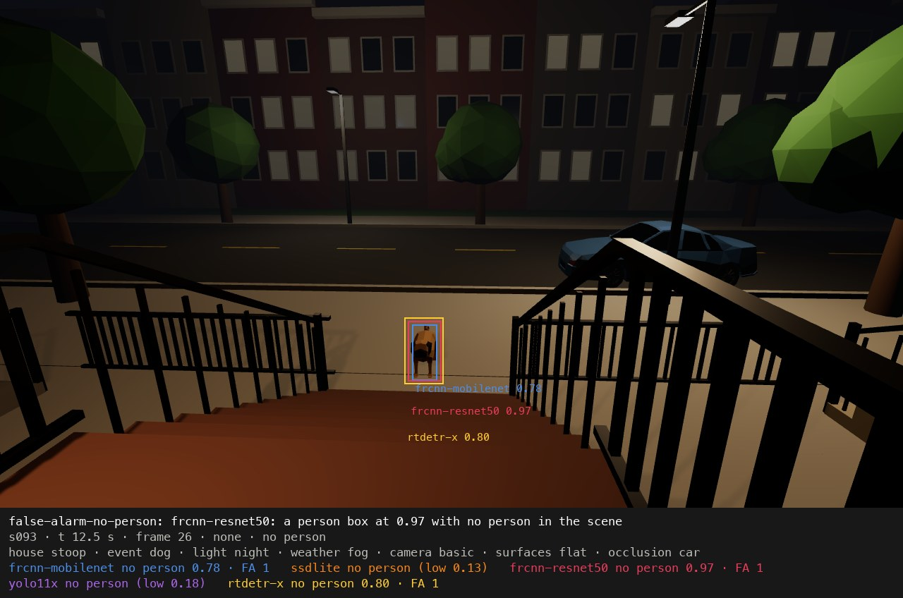

**frcnn-resnet50: a person box at 0.95 with no person in the scene**  
`s022` portico · dog · day · clear · fisheye · flat · car · t 9.5 s · [frame](https://antioch-demo-hoeksema.vercel.app/?house=portico&event=dog&light=day&weather=clear&camera=ring&person=man&speed=walk&surfaces=flat&occlusion=car&seed=812286&view=doorbell&t=9.5) · [replay](https://antioch-demo-hoeksema.vercel.app/benchmarks?scenario=s022&detector=frcnn-resnet50)

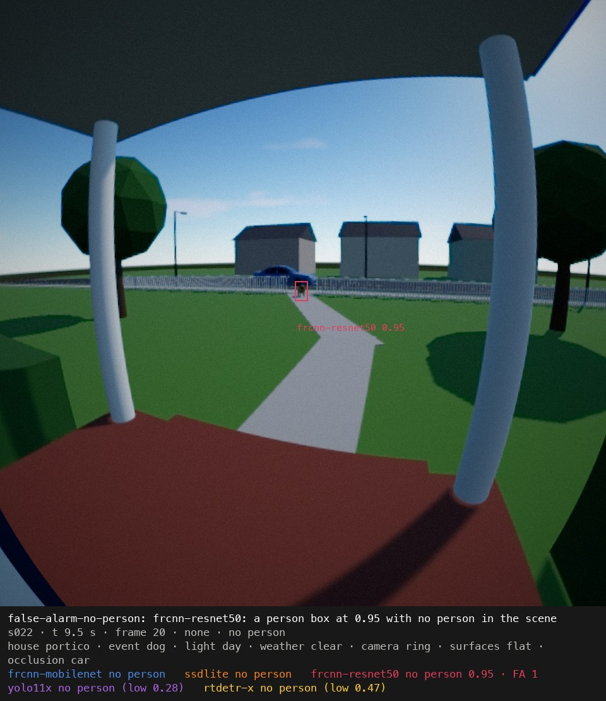

**yolo11x: a person box at 0.77 with no person in the scene**  
`s019` porch · dog · day · rain · basic · flat · none · t 12 s · [frame](https://antioch-demo-hoeksema.vercel.app/?house=porch&event=dog&light=day&weather=rain&camera=basic&person=man&speed=walk&surfaces=flat&occlusion=none&seed=846353&view=doorbell&t=12) · [replay](https://antioch-demo-hoeksema.vercel.app/benchmarks?scenario=s019&detector=yolo11x)

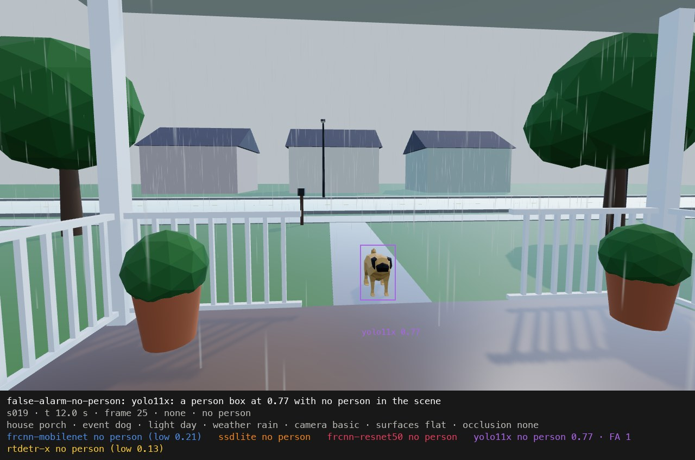

**yolo11x: a person box at 0.70 with no person in the scene**  
`s022` portico · dog · day · clear · fisheye · flat · car · t 16.5 s · [frame](https://antioch-demo-hoeksema.vercel.app/?house=portico&event=dog&light=day&weather=clear&camera=ring&person=man&speed=walk&surfaces=flat&occlusion=car&seed=812286&view=doorbell&t=16.5) · [replay](https://antioch-demo-hoeksema.vercel.app/benchmarks?scenario=s022&detector=yolo11x)

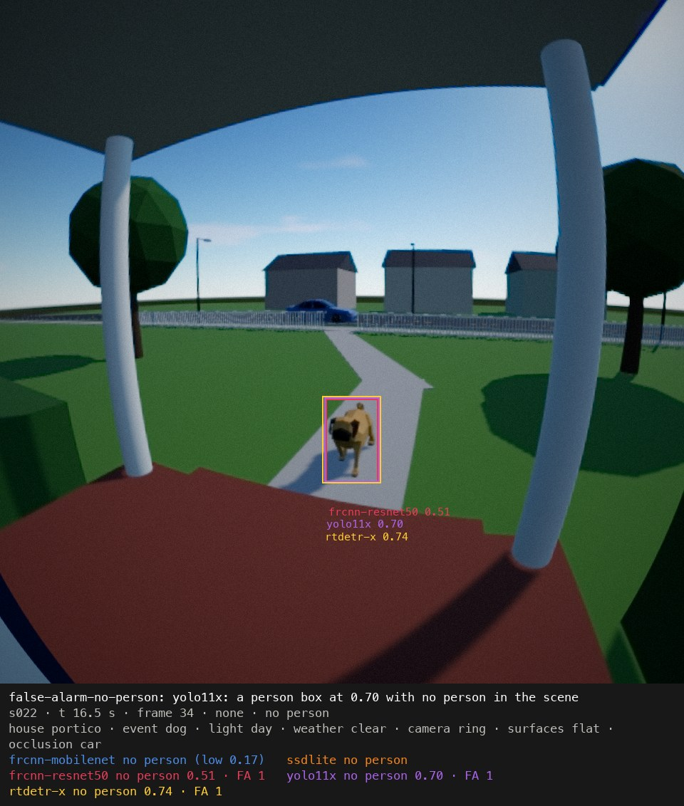

**rtdetr-x: a person box at 0.86 with no person in the scene**  
`s022` portico · dog · day · clear · fisheye · flat · car · t 17.5 s · [frame](https://antioch-demo-hoeksema.vercel.app/?house=portico&event=dog&light=day&weather=clear&camera=ring&person=man&speed=walk&surfaces=flat&occlusion=car&seed=812286&view=doorbell&t=17.5) · [replay](https://antioch-demo-hoeksema.vercel.app/benchmarks?scenario=s022&detector=rtdetr-x)

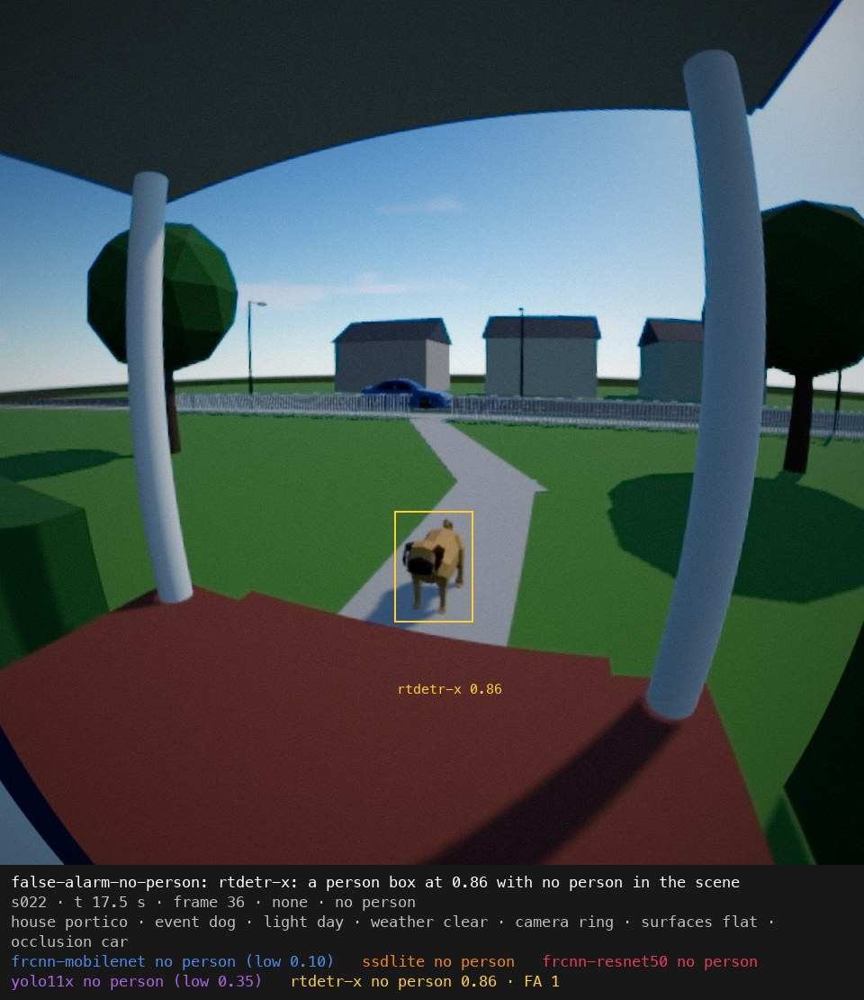

**rtdetr-x: a person box at 0.86 with no person in the scene**  
`s093` stoop · dog · night · fog · basic · flat · car · t 13 s · [frame](https://antioch-demo-hoeksema.vercel.app/?house=stoop&event=dog&light=night&weather=fog&camera=basic&person=man&speed=walk&surfaces=flat&occlusion=car&seed=724248&view=doorbell&t=13) · [replay](https://antioch-demo-hoeksema.vercel.app/benchmarks?scenario=s093&detector=rtdetr-x)

## Boxes away from the person

Counted person boxes that do not match the true box. Some are on the visible part of a partly hidden person (see Scoring notes on the Benchmarks page).

**a person box at 1.00 away from the person**  
`s098` porch · delivery · day · clear · basic · dark · walk · flat · bins · t 7 s · [frame](https://antioch-demo-hoeksema.vercel.app/?house=porch&event=delivery&light=day&weather=clear&camera=basic&person=dark&speed=walk&surfaces=flat&occlusion=bins&seed=910398&view=doorbell&t=7) · [replay](https://antioch-demo-hoeksema.vercel.app/benchmarks?scenario=s098&detector=frcnn-resnet50)

**a person box at 1.00 away from the person**  
`s056` side · delivery · day · fog · basic · woman · walk · textured · bins · t 22.5 s · [frame](https://antioch-demo-hoeksema.vercel.app/?house=side&event=delivery&light=day&weather=fog&camera=basic&person=woman&speed=walk&surfaces=textured&occlusion=bins&seed=772235&view=doorbell&t=22.5) · [replay](https://antioch-demo-hoeksema.vercel.app/benchmarks?scenario=s056&detector=frcnn-resnet50)

**a person box at 0.98 away from the person**  
`s030` stoop · delivery · day · rain · basic · child · walk · textured · none · t 13.5 s · [frame](https://antioch-demo-hoeksema.vercel.app/?house=stoop&event=delivery&light=day&weather=rain&camera=basic&person=child&speed=walk&surfaces=textured&occlusion=none&seed=254446&view=doorbell&t=13.5) · [replay](https://antioch-demo-hoeksema.vercel.app/benchmarks?scenario=s030&detector=frcnn-resnet50)

**a person box at 0.98 away from the person**  
`s027` side · delivery · day · rain · basic · hooded · walk · flat · car · t 9 s · [frame](https://antioch-demo-hoeksema.vercel.app/?house=side&event=delivery&light=day&weather=rain&camera=basic&person=hooded&speed=walk&surfaces=flat&occlusion=car&seed=146616&view=doorbell&t=9) · [replay](https://antioch-demo-hoeksema.vercel.app/benchmarks?scenario=s027&detector=frcnn-resnet50)

**a person box at 0.98 away from the person**  
`s083` side · delivery · day · snow · fisheye · man · run · textured · bins · t 9.5 s · [frame](https://antioch-demo-hoeksema.vercel.app/?house=side&event=delivery&light=day&weather=snow&camera=ring&person=man&speed=run&surfaces=textured&occlusion=bins&seed=253457&view=doorbell&t=9.5) · [replay](https://antioch-demo-hoeksema.vercel.app/benchmarks?scenario=s083&detector=frcnn-resnet50)

**a person box at 0.98 away from the person**  
`s067` side · delivery · night · clear · basic · dark · run · textured · none · t 9.5 s · [frame](https://antioch-demo-hoeksema.vercel.app/?house=side&event=delivery&light=night&weather=clear&camera=basic&person=dark&speed=run&surfaces=textured&occlusion=none&seed=350551&view=doorbell&t=9.5) · [replay](https://antioch-demo-hoeksema.vercel.app/benchmarks?scenario=s067&detector=frcnn-resnet50)

## Best and worst scenarios

The scenarios with the highest and lowest mean detection rate (a middle frame).

**best scenario: mean detection rate 84% (a middle frame)**  
`s037` flush · delivery · day · snow · fisheye · hooded · run · flat · none · t 7 s · [frame](https://antioch-demo-hoeksema.vercel.app/?house=flush&event=delivery&light=day&weather=snow&camera=ring&person=hooded&speed=run&surfaces=flat&occlusion=none&seed=376196&view=doorbell&t=7) · [replay](https://antioch-demo-hoeksema.vercel.app/benchmarks?scenario=s037&detector=frcnn-resnet50)

**best scenario: mean detection rate 84% (a middle frame)**  
`s006` flush · delivery · day · wind · basic · man · run · textured · none · t 7.5 s · [frame](https://antioch-demo-hoeksema.vercel.app/?house=flush&event=delivery&light=day&weather=wind&camera=basic&person=man&speed=run&surfaces=textured&occlusion=none&seed=594935&view=doorbell&t=7.5) · [replay](https://antioch-demo-hoeksema.vercel.app/benchmarks?scenario=s006&detector=frcnn-resnet50)

**worst scenario: mean detection rate 7% (a middle frame)**  
`s023` porch · delivery · IR · rain · fisheye · child · walk · flat · bins · t 17.5 s · [frame](https://antioch-demo-hoeksema.vercel.app/?house=porch&event=delivery&light=ir&weather=rain&camera=ring&person=child&speed=walk&surfaces=flat&occlusion=bins&seed=39387&view=doorbell&t=17.5) · [replay](https://antioch-demo-hoeksema.vercel.app/benchmarks?scenario=s023&detector=frcnn-resnet50)

**worst scenario: mean detection rate 22% (a middle frame)**  
`s021` side · delivery · IR · snow · fisheye · child · walk · textured · car · t 17 s · [frame](https://antioch-demo-hoeksema.vercel.app/?house=side&event=delivery&light=ir&weather=snow&camera=ring&person=child&speed=walk&surfaces=textured&occlusion=car&seed=93988&view=doorbell&t=17) · [replay](https://antioch-demo-hoeksema.vercel.app/benchmarks?scenario=s021&detector=frcnn-resnet50)

